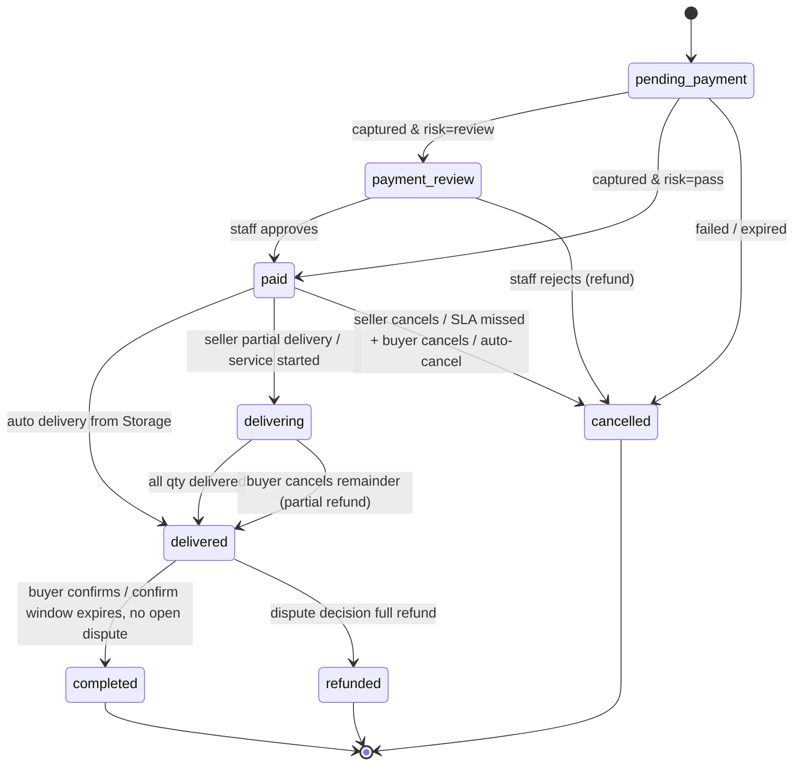

# X2KEY — Product Spec & Build Plan (Z2U-aligned architecture) — for Claude Code

> **What this file is:** the single source of truth for building X2KEY, a multi-vendor marketplace for digital game goods and services (currency, top-ups, items, boosting, accounts, video games, gift cards, coupons, subscriptions, software, DLC, eCards, eGift cards, retail gift cards, mobile recharges).
>
> **v2 change:** v1 deliberately diverged from Z2U (no cart-style hubs, no accounts/boosting, no buyer credits, no affiliate program, its own order statuses). **v2 re-aligns the information architecture, feature set and user flows with the live Z2U site** (as observed in screenshots taken 2026-11-22), while keeping v1's engineering core: integer money, double-entry ledger, explicit state machines, idempotent webhooks/jobs, encrypted
 secrets.
>
> **Status:** Draft v2.1 — 2026-11-22 (Part 1 verified against the live site, logged in). Items marked **⚠ DECISION** need a founder answer; each has a default so work is not blocked. Items marked **(observed)** were seen on the live site; **(inferred)** are reasonable guesses about behaviour behind what was seen — verify before treating as requirements.
>
> **Matching architecture ≠ copying.** Replicate structure, flows and features. Do **not** copy Z2U's name, logo, artwork, copy text, policies, or scrape its catalog/content. Use original branding, illustrations and legal texts.
>
> **Not legal, tax, or financial advice.** Part 2 flags regulatory risks (stored balances, accounts/boosting categories, VAT) that need a qualified lawyer/accountant.

---

## 0. How to use this file

### 0.1 For the founder
Read **Part 1** (reference architecture) and **Part 2** (risk flags + decisions). Answer **§2.3 Founder decisions** before Milestone 6.

### 0.2 For Claude Code
1. Put this file at `docs/X2KEY_SPEC.md`.
2. Create `CLAUDE.md` at repo root:

```markdown
# X2KEY
Multi-vendor digital game goods marketplace, IA modelled on Z2U. Full spec: docs/X2KEY_SPEC.md (read the relevant Part before each task).

## Non-negotiable rules
- Money = integer minor units (bigint) + ISO currency. Never floats. Use brick/money.
- Every money movement (payments, credits, coupons, affiliate, withdrawals) = one balanced journal (Part 7). Never UPDATE a balance column directly.
- Points (X2K Score) are NOT money: separate points ledger, same append-only rules.
- Order/dispute/ticket/withdrawal status changes go ONLY through their state machine classes (Part 6). Each transition writes a history row.
- Webhooks and scheduled jobs must be idempotent.
- Storage items (keys, account credentials, codes) are encrypted at rest; every reveal is audit-logged.
- Catalog is game-centric: Game → GameCategory (game × category type) → Product → Offer.
- Domain code lives in app/Domains/<Domain>. Controllers/Filament stay thin.
- Every milestone ships with Pest tests; `composer test` and `composer stan` must pass.
- Current milestone: docs/PROGRESS.md
```

3. Keep `docs/PROGRESS.md`, `docs/DECISIONS.md` (ADR), `docs/OPEN_QUESTIONS.md` up to date.
4. Work one milestone at a time (Part 22).

---

# PART 1 — Reference architecture (what we are matching)

> Verified on the live site on 2026-11-22, both logged out and logged in as a seller account. Personal data from that account is deliberately left out of this file. **(observed)** = seen on the site; **(inferred)** = our reading of it.

## 1.0 Visual design system (observed, measured from computed styles)

| Token | Value seen | X2KEY equivalent (use our own brand values, same roles) |
|---|---|---|
| Base font | Roboto, 14px, colour #111 on white | `--font-body` 14px, `--text` |
| Display font | Nunito (section titles such as "Hot Game", "Trending Top up"); serif display face in hero headline | `--font-display` |
| Primary | red-orange ≈ #EE3524 (Buy Now, search button, active sidebar group, links like "View More"), hover darker ≈ #D72F1E | `--primary`, `--primary-hover` |
| Dark surface | navy ≈ #090723 (footer, dark home bands, header on dark pages) | `--surface-dark` |
| Category colours | Hot Game cards: orange ≈ #FB7600 (Currency), purple ≈ #5900B5 (Items), navy ≈ #333D7B (Accounts), blue (Gift Cards) | `--cat-*` per category type |
| Buttons | Primary: filled red, 5px radius, ~50px tall in the buy box. Secondary: outlined pill (radius 999px, 1px red border, red text) e.g. "View More", "Become Seller", "Discover All" | `Button` variants `primary`, `outline-pill`, `ghost` |
| Cards | white, 1px border rgba(0,0,0,.12), 6px radius, shadow 0 1px 2px rgba(0,0,0,.1) | `Card` |
| Status colours | green (Verified, Passed, Positive), red (Negative, violations, discount badge), orange (warnings, "Publish" label, notice boxes with orange left border and pale background) | `--success`, `--danger`, `--warning` |
| Layout | full-width header (≈ 64px), centred content ≈ 1200–1300px; dashboard = 280px left sidebar + content on light grey (#F5F6FA-ish) background with white cards | `PublicLayout`, `DashboardLayout` |
| Icons | line icons with a small filled accent; crown icons for seller level; shield icon with a number for insurance days | icon set of our own |

Responsive (observed at ~730px width): the header collapses to logo + menu + locale + icons; the search moves into the menu; dashboard sidebar becomes a drawer; category tiles wrap; table rows become stacked cards.

## 1.1 Global shell (observed)

| Element | Logged out | Logged in |
|---|---|---|
| Left | Logo, hamburger (☰) | same |
| Centre | Search input "Search for games, top-ups, items, game service and more" + category select (All Categories + 15 types) + red square search button | same |
| Right | Locale pill (flag · `EN \| USD`), **"Become Seller"** outlined pill, **"Login / Register"** filled red pill | Locale pill · **chat icon** (green badge, unread conversations) · **announcement bell** (orange "99+" badge, mute toggle) · **avatar** (initial on red circle, green online dot) |
| Under header | Dark tooltip "If you like it, click Ctrl+D to bookmark this website · No more prompts" (on mobile: "Click ⋮ to bookmark"); PWA prompt "Install Z2U? … add a shortcut to your desktop · Cancel/Confirm" | same |
| Cookie banner | Bottom-right card "We use cookies…" with **I agree** (red) / **I decline** (grey) | same until answered |
| Seller stock bar | — | Sticky bottom blue bar: "The listing of *{offer titles}* have insufficient product storage, please check and replenish" + red × |
| Floating rail (dashboard) | — | Right edge: Home · Announcement (badge) · Chat (badge) |

**Locale/currency modal (observed):** two selects. Currencies: USD, EUR, GBP, CAD, AUD, BDT, BHD, BRL, CNY, CZK, EGP, GHS, HUF, IDR, ILS, JPY, KRW, KWD, MAD, MYR, NGN, NPR, NZD, OMR, PHP, PKR, PLN, QAR, RON, SGD, THB, TRY, TWD. Languages: English, 简体中文, Deutsch, Français, العربية, Español, 한국어. Country is detected (cookie `user_country_code`) and shown as the flag. Settings are stored in cookies (`currency`, language var).

**Mega menu (☰):**
- Logged out: columns **per category type** (Currency, Items, Boosting, Gaming Accounts, Video Games, Top up, Gift Cards, Software & Apps, Accounts, …), each listing ~10 top games + "View All" → `/catalog/{type}`. Footer links: Game list, Item store, How to buy, **Sell at z2u**.
- Logged in (screenshot): grid of popular **games**, each with category chips and live counts (e.g. Steam → Accounts (5066) · Video Games (4493) · Gift Cards (1348) · Game DLC · Top up · Market Trade · Items · Boosting); "View All" → Game Index.

**Account dropdown (observed):** avatar, nickname, "User Level" icon, **Account ID**; Z2U Credits Balance → credits log; Z2U Score → *Redeem* page; Available Balance → withdrawal page; then Dashboard, Buy, Seller Center (with **My Store** shortcut showing shop name), Dispute Center, Service Ticket, Announcement, Invoice, Coupon, Affiliate Program, Storage, Settings, red full-width **Logout** bar.

## 1.2 Category types & URL scheme (observed)
Types (id in URL): Currency/Gold `1` · Top up `2` · Items `3` · Boosting `4` · Accounts `5` · Video Games `9` · Gift Cards `10` · Subscriptions `12` · Software & Apps `14` · Mobile Recharges `19` · plus Coupons & Savings, Game DLC, Gaming eCards, eGift Cards, Retail Gift Cards.

| Page | URL pattern |
|---|---|
| Category hub (all games of a type) | `/catalog/{type-slug}` e.g. `/catalog/account`, `/catalog/top-up` |
| Game × category listing | `/{game-slug}/{label-slug}-{typeId}-{gameId}` e.g. `/fortnite/accounts-5-4592`, `/steam-global/Gold-1-4249`, `/project-gorgon/councils-1-38553` (label = game-specific currency name) |
| Vanity aliases for big games | `/fc-coins`, `/nba-2k-mt`, `/madden-coins`, `/fc-points`, `/nba-2k-vc` … |
| Catalog product (many sellers) | `/product-{id}/{slug}.html` |
| Single seller offer | `/items-{id}/{slug}.html` |
| Seller store | `/shop/{username}` |
| All products with facets | `/ItemStore.html` |
| Game Index | `/gamelist` (A–Z + HOT tabs) · all game×category list `/searchAllGame` |
| News | `/news`, `/detail/{slug}.html` |
| Help | `/faqList/home`, `/faq/{slug}.html` |
| Affiliate landing / referral link | `/affiliate` · `/r/{code}` |
| Sell | `/sell/create` (`/sellprocess` redirects here) |

## 1.3 Home page modules (observed, top → bottom)
1. **Hero** (dark animated background): tagline "Discover the favorite marketplace…", huge serif headline, tilted gradient badge; **8 category tiles** (dark translucent squares, white icon + label): Currency, Top up, Items, Boosting, Accounts, Video Games, Gift Cards, Coupons & Savings.
2. **Browsing History** (cookie `user_history_records`, list of offer ids) — cards: thumbnail, title (2 lines), seller avatar + name + crowns, price; × per card; "Remove All 🗑" pill.
3. **Hot Game** — 4 tall colour cards (Currency/Items/Accounts/Gift Cards) with a game icon overlapping the top edge; 4 rows "Game name …… (count)"; white "View More" button.
4. **Trending Top up** (purple gradient band) — 1 large featured tile + 2×4 tiles (cover art, "N Offers" chip top-right, name bottom); "Discover All ›" outlined pill.
5. **Trending Gift Cards** — 5-tile carousel, arrow + dots.
6. **Trending Video Games** — same.
7. **Community ratings** — 4 review cards: stars, positive %, text, avatar, date, username; carousel dots.
8. **Affiliate banner** — purple gradient card, headline, red "Join Z2U Affiliate Now!" button, QR code "Scan to learn more", illustration on the right.
9. **New Game** — 4 white cards × 10 link rows (newest game×category pages).
10. **Game News** (dark band) — 4 article cards (title, red date, excerpt, outlined "View More ›"), dots.
11. **Payment strip** — GCash, Google Pay, Apple Pay, Pix, Visa, Mastercard, dotpay/BLIK, Klarna/Sofort, iDEAL, Neteller, Neosurf.
12. **Footer** (navy) — Z2U.COM / SUPPORT / LEGAL / Policies columns, social circles (X, Facebook, Instagram, YouTube), locale button, "Google Safe Browsing" badge, "Add to Preferred Sources" pill, SEO keyword row, disclaimer, company line.

## 1.4 Listing pages

### 1.4.1 Game × category listing (observed: `/fortnite/accounts-5-4592`, GTA VI video games)
- Breadcrumb `Home › Accounts › Fortnite Accounts`.
- **Category tabs** with icon + count for every category of the game (Accounts 4049 · Game DLC 1299 · Items 405 · Top Up 291 · Gift Cards 100 · Boosting 17); "Go to sale" blue button on the right.
- **Important Notice** (orange-bordered box, ×): independent sellers, no publisher affiliation, ToS risk, trademark owner line (per game).
- **FILTER sidebar** — generic: Online sellers toggle · Product Name search + **Hot Search** tag cloud · Price range (from–to). Then **filters defined per game×category**, e.g. Fortnite Accounts:
  - *Accounts Type* (checkbox + count): Skin Account, V-Bucks Account, Random, Boutique old, Account hire, Other
  - numeric ranges: V-Bucks Amount, Account Level, Outfits/Pickaxes/Emotes/Back Bling/Gliders Amount
  - multi-select with counts: Own Hot OG Outfits (13 More…), USP tags, "Linked to" platforms
  - booleans: Full Mail Access YES/NO
  - enum: Account information changeable (immediately / after 1–3 months / unable)
  - Account Age sliders (years 0–20, months 0–12)
  - Video Games: Attribute (delivery method), Platform, Region (searchable, "22 More"), Country.
- Results header: "**N Product Contain M Offers**", list/grid toggle, Sort.
- **Two card types in one grid:**
  - **Product card** (catalog product): cover, region flag + platform badge, title, tags (Global, gift/Account), "N Offers", "from $X", MSRP strikethrough + red discount % (e.g. −15%).
  - **Offer card** (`productCardStyle-2`): title (2 lines) on top, image area with overlay badges — ✔ *Verified Seller*, shield + **"30"** = *Free Insurance for 30 days*, delivery time label (15mins / 1H / 48H / instant) — footer: seller avatar (online/offline ring), name, crown icons (seller level), "from $X".

### 1.4.2 Category hub `/catalog/{type}` and `/searchAllGame`
Type tabs (All + 15), "Search Results N Results", A–Z / 0-9 filter, "Unable to find desired results? click feedback", Trending block, then all games as tiles with "N Offers".

### 1.4.3 Item Store `/ItemStore.html`
Global listing with facets and counts across everything: **Service** (Video Games 143,906 · Top up 26,408 · Game DLC · Accounts · Items · Currency · Gift Cards · Subscriptions · Software & Apps · Coupons & Savings · Boosting), **Attributes** (= delivery methods: Digital key · Manual Top Up · Account Ownership Transfer · Send a gift · In-Game Trade · Direct Top Up · Invite · In-Game Services · Account Usage Rental · Personalized Customization · Comfort Trade (Safe) · Promotional Redemption Link), **Platform** (Xbox live, Steam, RBL, Microsoft Store, PSN, Nintendo, EPIC, Apple, Activision, Battle.net, EA …), **Region**, **Appliances** (Xbox Series X/S, Xbox One, Windows, PS5, Switch …).

### 1.4.4 Game Index `/gamelist`
Intro + "let us know" link, tabs HOT · A…Z · #, each game with its category links and counts.

## 1.5 Product & offer pages (observed)

**Catalog product page `/product-{id}`** (several sellers):
- Breadcrumb, title, "Report Listing" link.
- **Buy box** (featured offer = "Recommended"): seller name + positive % + Chat button, stock label ("Adequate stock" / "In stock"), qty − / +, "1 = USD $84.99", MSRP strikethrough + discount, big price, note "Excludes payment processing fees", full-width red **Buy Now**, link "+4 Offers From $84.99", attributes (Works on: Xbox Series X/S · Delivery Time: 1 Hours).
- **Other Sellers (N)** panel: Online sellers toggle, delivery-method chips (Send Code · Gift Giving · Login Top Up · Order Delivery), price range, sort (Recommended · Price Ascending). Rows: seller, positive %, delivery method, delivery time, stock, Min QTY, insurance days, price, "Lowest Price" tag.
- Product Description (rich text from catalog, any language), "Looking for more …? Visit main category", Browsing History strip; sticky buy bar on scroll (inferred from duplicated price block).

**Single offer page `/items-{id}`**: same buy box without the other-sellers panel; attribute list: Platform, Delivery Method ("Order Delivery"), Delivery Time ("30 minute"), Free Insurance ("30 Days"); seller description.

## 1.6 Checkout & order (observed via order details; we did not place an order)
- Order number format `X` + 10 digits.
- Price lines: Amount, Discount Amount (store coupon), Platform Discount, **SERVICE CHARGE** (buyer payment fee, e.g. $1.00 → $1.46), SUBTOTAL, PAYMENT METHOD (e.g. Airwallex, credits).
- **Order timeline** (reverse chronological log, observed wording):
  `Your order has been created` → `automatically approved by the system and submitted to the seller, waiting for the seller to receive the order` → `Seller changed order status to: Restocking` → `…: In trading` → `Seller has submitted relevant information` → `…: In Delivered, QTY:1` → `The system auto confirm, QTY:1` (3 days later) / `Buyer confirms receipt`.
- Final statuses seen: **TRADE CLOSED** (unpaid, "you failed to pay this order"), **CANCELLED – Refunded to credits balance**, Completed, Refunded.
- "view snapshot" link = frozen copy of the offer at purchase time.
- **Not received** modal: buyer must contact seller within **48 h**; if unresolved, report within the **next 48 h**, otherwise the complaint auto-closes.
- "My Journey — Recommended Items" carousel (recently viewed + similar) with "Not interested".

## 1.7 Dashboard (observed, full tree with routes)

```
Dashboard (/My/index)  — no sidebar: blue gradient hero (avatar, nickname ✔, Credits Balance, Seller Level icons,
                         User Level), centre "USD $X Available Balance" + red pill "VIEW ALL", right stat boxes
                         (Success Rate % out of N Orders · Sold Orders in Processing); My Journey carousel;
                         then the menu as a grid of white cards (4 per row), one per group.
Buy
  Purchase Orders            /buyOrder/index            tabs: All · Unpaid · Waiting for delivery · Delivered · Not Commented · Completed · Refunded
  Purchase Order Comment     /userComment/send          feedback score table (7d/30d/All × Pos/Neu/Neg), % positive, tabs All/Positive/Neutral/Negative, edit modal
  Credits Balance            /UserCenter/creditsLog     "what is credits balance?", month selector, Date · Description · Currency · Amount · Balance · Status · Action
  Points Record              /UserCenter/myScore        current points, month selector, Date · Order number · Score · Points behavior · Status
  Funding Details            /UserCenter/fundList       Funds Outflow / Inflow totals, month selector, Order number · Type · Amount · Date
  My Favorites               /UserCenter/myFavorite     cards: title, game, category, price
Seller Center
  Sold Orders                /sellOrder/index
  Create New Offers          /sell/create
  Active Offers              /sell/manage → /sell/manageList?service={typeId}&game={gameId}
  Store Management ▸
    My Store                 /shop/{username}
    Service Application Status /sell/serviceApplyList   seller must apply per game×category before listing
    Product Coupon Settings  /userCoupon/sell           public store coupon codes
    Recommend Coupons        /userCoupon/sell?is_show=2 private codes for marketing emails
    Sell Order Comments      /userComment/receive       feedback received + sub-scores + Reply
  Marketing Campaign ▸
    Marketing Email          /UserCenter/market
    Mail promotion records   /UserCenter/mkRecord
  Withdrawal Management ▸
    Withdrawal Record        /payment/paymentLog
    Withdrawal Account       /payMent/p_index?status=2
  Seller Information         /UserCenter/sellInfo
  Violation Center           /userViolate/violateList
  Merchant Services Contacts /sell/contact
Dispute Center
  Disputes                   /DisputeCenter/index       "Resolution Center"
  Dispute Statistics         /DisputeCenter/disputeStats
Service Ticket
  All Ticket · Pending · Awaiting Reply · Closed   /faq/serviceList[/1|/2|/3]   (new ticket = /support/contact)
Announcement
  All · Unread (badge) · Read · Starred           /userCenter/userAnnouncement[?is_read=0|1|?is_mark=1]
Invoice
  Service invoices /serviceInvoice · Withdrawal voucher /withdrawInvoice · Invoice info /invoice
Coupon
  Get shopping coupons /userCoupon/index · Get platform coupons /userCoupon/redPacket
Affiliate Program
  Manage /Distribution/index · My Affiliates ?myaffiliates=1 · Promotional video records /distribution/videoRecord
  · Alliance Bill /distribution/allianceBill · Creative Assets /distribution/promoteMaterial
Storage  (every page gated by "Enter Privacy Password" → /user/verify_pass.html?referer=…)
  Storage Category /userStorage/index · Storage List /userStorage/product · Recycle Station /userStorage/recycleProduct
  · Delivery Logs /userStorage/autoDeliverLogs
Settings
  Account Settings /userCenter/index · Security Settings /userCenter/account · Certification Center /UserVerify/index
  · Delete Account /userCenter/deleteAccount
Points redeem: /store/redeem      Chat: /Chat
```

**Sidebar UI:** white column with group rows (coloured icon + label + chevron); open group has a solid red header with white text; children are indented "› label" rows, active child in red; badges (e.g. "797" red pill) on Unread messages. Page area: breadcrumb (🏠 Home / Page), white card with bold title and icon.

## 1.8 Seller Center screens (observed)

### Sold Orders
Tabs with counts: All · Pending delivery · Delivered · Pending feedback · Canceled. Filters: Game (only games the seller sells), category (15 types), Order number, Product Title, **Internal remarks**, From/To, red Search. Sub-status chips: New Order · Delivering · PREPARING · ISSUE. Columns: Product · Unit Price · Type · Status · Internal remarks ⓘ · Total Amount · **Acquisition cost**. Empty state: grey "!" circle + "No Results Found".

### Create New Offers (`/sell/create`, single long form)
1. Red legal banner (prohibited listings link).
2. **Selling Items:** autocomplete "Enter product name here" + type chips (All + 15), "Can't find it? Request for new name", "You may be looking for these products".
3. **Limited-Time Service Fee Discount** box (when the game×category runs a fee promotion: reduced rate, period in UTC+8, rules link).
4. **Batch Release:** Upload List / Download List (template) — only for sellers above a level; revoked if dispute or completion rate drops.
5. **Product Types / Game details:** dynamic attribute form per game×category, "Add Custom Program".
6. **Product Description** (rich text; note: no contact info allowed).
7. **Price Setting:** currency (USD/EUR/GBP/CAD/AUD), stock, min/max purchase, **Integer Multiple Required** (qty must be a multiple of min), unit price with "≈ USD", total, **receivable amount**; *or* for unit goods: Min/Max Unit Per Order, Stock, Require Integer, "I want to get" ⇄ "Price Per Unit" calculator, **profit** after platform fees and costs, **Acquisition cost (optional)**; **Add Discount Settings** (quantity tiers); notice about **category base price** (below it a % add-on is shown to buyers without changing seller profit or price ranking).
8. **Product Expiration Date** (listing duration, e.g. 7 days, renewable via "Extend duration").
9. **Delivery Option:** DELIVERY ETA select (15 min, 30 min, 45 min, 1 h … 48 h), "No available trading methods? Apply to add", warning that missing ETA lets buyers cancel free and Z2U may charge full commission as penalty.
10. **Insurance:** some products are in **compulsory insurance** — seller income is released to available balance **in installments during the insurance period**; insured offers rank first.
11. **Publish Time:** Publish Immediately / Pending Publish.
12. Terms checkbox → Submit.

### Active Offers
- Landing `/sell/manage`: "Violation Center" + "Hide Shop" buttons, fee-change notice (e.g. per-game **add-on fee 10% charged from buyers**), type tabs with counts (Currency 1 · Accounts 148 · Gift Cards 1), search, then game×category cards "N Offers".
- Group list `/sell/manageList?service=&game=`: status tabs **All Listing · Expire soon · Low Stock · Deactivated · Pending Publish · System Deactivated · Auto Delivery** (counts); filters: unit price, stock, minimum purchase, Allow Automatic delivery (Yes/No), search; batch buttons **Batch sort · Authorized card coupon warehouse · Deactivate · Relist · EXTEND DURATION · Delete · Batch Update**; page size 20–100; sort Default/Latest/Lowest/Highest. Table: Select · Product Name (status label "Publish", date, offer #id, deletion reason line in red if system-deactivated) · **Sort** (inline number) · Attribute · Min QTY · **Unit Price** (inline editable) · Stock (count + delivery time) · Delivery Method · Product expiration date · Status · Action (Edit, Deactivate/Relist, Delete).

### Service Application Status
Seller must be approved per game×category ("Service"). Table: Service Name · Status (Passed/Refused) · Action (publish product / reapply) · Notice (reject reason) · Created · Audit time.

### Coupons (seller)
"My Coupon Codes": Add · Edit Expired time · Batch delete. Columns: Code (badge "35% OFF Code 35OFF") · Shop · Game · Game category · Use times (used/limit) · Is publicly · Expired · Action. Add modal: Code(s) (multi-line batch), Discount %, Game, Game category, Use times, Expired. Public codes show to all buyers in the store; non-public ("Recommend Coupons") are attached to marketing emails.

### Marketing Email
Daily cap 1,000 / monthly 10,000 emails. Steps: select mail type (New Product Promotion · Limited-time discount · Exclusive Offer for Long-Term Customers · Inventory Clearance) → select game/category/product + recommend coupon → select past buyers (date range, select all) → Mails Preview → cost summary (count × price per email) → Send. **Mail promotion records**: Type · Quantity · Unit Price (e.g. $0.001) · Total · Status (Settled/Unsettled — billed next day from balance) · Created.

### Withdrawal
`/payMent/p_index`: balance breakdown — **Store Deposit** (security deposit required for Boosting sellers; "TOP UP"), **Revenue Reserve** (% held from each order), **Not Available** (frozen by disputes), **Available**; General Reserve and Total balance; 4-step wizard **1 Balance → 2 Withdraw to → 3 Amount → 4 Confirm**; "Complete authentication now" if not verified. Payout methods with fees shown per account, e.g. PayPal 2.99% + 0.99 USD, USDT-TRC20 3.99% + 3 USD, Payoneer 2.99% + 2.99 USD, "Add New Account", more methods by payout currency (≈ 40 currencies). **Withdrawal Record** (last 3 months): Number · Account (masked) · Withdrawal Price · Payment price (after FX/fee, e.g. USDT) · Withdrawal Date · Payment Date · Status (e.g. *Issues*) · Transaction Remarks ("please resolve order issue Z…") · Action.

### Seller Information
Shop Name, Store Avatar, Store Banner, Store Description (modify/save); Store operation information: Store Sale Status (Activate), Available Services list.

### My Store (public profile, edit mode for owner)
Promotional banner (1920×200), store image, name, seller level explanation (based on completed orders), Contact, "View my profile as a Public", member since, **Order completion %** (successful orders), **Order Dispute Rate (last 3 months)**, Total reviews, positive % (90 d / all), **store video** (mp4/mov ≤ 30 MB), description, **languages spoken** with level, **Store Level** (Bronze…) and **Buyer Level** (Silver → Gold progress bar "Spend X USD again to upgrade"), Seller Feedback, **Featured List** (up to 4 featured offers).

### Sell Order Comments
Feedback score table, % positive, **Transaction level** with average score and sub-scores **Delivery Speed · Service Quality · Item Description** (1–5), tabs All/Positive/Neutral/Negative, Reply per comment; buyer names masked (`fauvu***uvu`).

### Violation Center
Counters: Pending · Under Appeal · Processed · No complaints required. Filters: Type of Violation (**Product Violation · Shop Violation · Dispute Rate Anomaly · Order Anomaly**), Appeal Status (Pending · Appealing · Success · Fail · No complaints required · No Appeal). Rows: type + #id, violation reason, **Type of Penalty** (e.g. hidden listings, Recovery), created, action (Appeal).

### Merchant Services Contacts
Merchant services email + "Submit Ticket Now".

## 1.9 Shared dashboard screens (observed)

- **Dispute Center ("Resolution Center")**: counters Open Cases / Close Cases; quick filters *Response Required · Under Review · Awaiting other party's response*; search; columns Case Id · Order number · Reason · Status · Amount · Last updated on · Action. **Dispute Statistics**: period (This Month / Last 30 days / Custom), game, category → per game×category: number of disputes, proportion, dispute rate, refund resolution rate, total.
- **Service Ticket list**: "Z2U Support Center", red "Commit Tickets" button, filter All Tickets, sort; each row: *topic : user text*, optional "Order number: Z…", Created on, Last Reply, state line ("This ticket has been Closed"); pagination. **New ticket** (`/support/contact`): "Please answer some questions…" → topic select (Registration · Account issues · Buying and paying issues · Selling issues · Refund issues · Report and After-sales service · I want to report another problem · Product/category creating issues) → dynamic follow-up forms; e.g. *new game/category request*: Game Name*, Official Website, Platform*, Area*, Server*, Product Type*, Keywords*, Delivery Method, Remark, images (jpg/png/gif); *new product request*: Game, Website, Product Name, Estimated monthly demand (USD range). Side box: Merchant / Customer / Dispute service emails.
- **Announcement**: left filter (All/Unread/Read/Starred), title search, **type tabs with counts: All · To-do · Announcement · Order Reminder · Dispute Reminder · Platform Service Reminder · Merchant Reminder**; bulk Delete · Mark as read · Mark all as read · Delete all; star/unstar; rows show "New" badge + timestamp.
- **Invoices**: Service invoices generated automatically on the 1st of each month for the previous month — Period · Invoice Number (`HPD-…`) · Total · View. Withdrawal vouchers generated after each payout — Date · Number (`HPW-…`) · Total (payout currency) · View. **Invoice info** form: Type (personal / company), Invoice header*, Address*, VAT, Postal Code*, City*, Country*; warning that false info = user's tax risk.
- **Coupons (buyer)**: "Use this code in designated store…"; grouped by game with counts (e.g. Steam Coupons: 21) → claimable seller codes; platform coupons ("red packets") list.
- **Affiliate — Manage**: tabs Home / My Affiliates; **Affiliate Balance** + "Transfer to Wallet" (min 10 USD); Direct / Indirect affiliates counts; table Member · Register Date · Country · Recent Transaction · Affiliate Rank; **commission rule shown: 20 % of Z2U's net profit on invitees' purchases + 3 % on second-level invitees**; Invitation via link (`/r/{code}`, clicks, total profit, Copy), **Create Promotional Links** (step 1: paste any Z2U page URL), Share, **Create Code** (custom referral code), Award Summary. **Video records**: Video link · Views(K) · Estimated bonus · Actual bonus · Status · Created. **Alliance Bill**: Type (All · User Promotion · Merchant Promotion · Video Promotion), dates → Date · Type · Earning · Affiliate Rank. **Creative Assets**: theme selector (Universal + popular games), click image → choose size → download. Public `/affiliate` landing: ticker "S****a earned $1116 this week", "earn up to 20 %", 4 steps, FAQ.
- **Points**: header shows Score; **Redeem Z2U Score** page: coin illustration, "only available to redeem once per day", amount field (min 50,000), "Redeem now" (converts points to credits — inferred).
- **Settings › Account**: avatar, username, **Buyer Level** ("What is a buyer level?"), nickname, email, **instant messengers** (WhatsApp, Telegram, QQ, Microsoft Teams), **social account binding** (Google, Facebook, Steam, X, Discord, TikTok, Line — Bind/Untie), Personal (name, last name, identity number, gender, DOB), Billing address, Preference setting.
- **Settings › Security**: Email (verified, edit), Password (change kills sessions), Mobile number (verified), **Privacy Password** (second password protecting sensitive areas such as Storage; change kills sessions), **MFA** (authenticator, "How to setup?"), Promotional email from sellers toggle.
- **Certification Center**: Email authentication · Identity authentication · Payment authentication (after identity) · Store authentication (individual seller certification) · Enterprise certification · **Contract Sign** (platform cooperation agreement, View).
- **Delete Account**: irreversible notice, agreement checkbox, Confirm Delete → choose verification (Email token + SMS token · Email token + Privacy Password · SMS token + Privacy Password · Authenticator) → token step(s) → Submit.
- **Chat `/Chat`** (full-screen app): left column — logo, notification bell, online-status toggle, search, "User Management" toggle, tabs **All / Unread / Read** with counts, conversation list (avatar, name, last message, time, red unread badge, ⋮ menu). Right — orange warning bar ("do not share delivery info by phone…, all payments and chats only on platform…"), empty state with mascot and platform icons, "Welcome to Z2U chat", **trading safety tips** carousel.


## 1.10 What the live check changed in this spec (applied in Parts 5–27)

| Finding | Where it lands |
|---|---|
| Sellers must be **approved per game × category** before listing ("Service Application") | 5.3, 6.9 |
| **Insurance**: offers carry N insurance days; insured income is released **in installments**; insured offers rank first | 5.4, 7.5 |
| Listings **expire** (≈7 days), can be extended/relisted; Pending Publish, Deactivated, System Deactivated, Expire soon, Low Stock | 5.4, 6.2 |
| Seller **Sort** number per offer and up to 4 **featured offers** on the store | 5.3, 5.4 |
| Seller stages shown to buyer: **Restocking → In trading → info submitted → In Delivered → auto-confirm** | 6.1 |
| **Not received**: contact seller within 48 h, then report within the next 48 h or it auto-closes | 6.1, 27 |
| Buyer **service charge** (payment fee) + optional per-game **add-on fee** (e.g. 10 %) + category **base price** | 9.1 |
| Seller balances: **Store Deposit**, **Revenue Reserve**, **Not Available** (disputes), **Available** | 7.1 |
| Payout methods with per-method fee (PayPal, USDT-TRC20, Payoneer…) and payout currency | 5.16 |
| Store coupons = **% codes** per game/category with use limits, public or private ("Recommend") | 5.14 |
| **Paid marketing emails** to past buyers (1 000/day, 10 000/month, settled next day) | 14.3 |
| Affiliate: **20 % of platform net profit** + **3 % level 2**, custom code, transfer to wallet ≥ 10 USD | 15 |
| Points: redeem **once per day, min 50 000** → credits | 7.7 |
| **Privacy Password** gates Storage and sensitive actions; deletion needs two factors | 5.1, 23 |
| Storage **Recycle Station** + **Delivery Logs** | 5.5 |
| Feedback Pos/Neu/Neg + sub-scores Delivery Speed, Service Quality, Item Description | 5.11 |
| Announcement types: To-do, Announcement, Order, Dispute, Platform Service, Merchant | 5.9 |
| Ticket **topics** with dynamic forms (incl. new game/category/product requests) | 5.10 |
| Invoice numbers `HPD-` (monthly service) / `HPW-` (withdrawal) | 5.16 |
| Certification incl. **Contract Sign** and Enterprise; social bindings; messenger handles | 5.1 |

---

# PART 2 — Risk flags & founder decisions

## 2.1 Category risk matrix (all categories are built; each is enabled by config)

| Category type | Main risk | Default at launch |
|---|---|---|
| Video Games, Game DLC, Gaming eCards (keys) | Revoked keys from stolen cards, region locks | ✅ enabled, settlement hold ≥ 7 d for new sellers |
| Gift Cards, eGift, Retail Gift Cards | Card-testing, laundering, already-redeemed codes | ✅ enabled for verified sellers only |
| Top up, Mobile Recharges | Upstream stolen-card fulfilment, "not received" | ✅ enabled, proof required |
| Currency, Items | Game ToS violations; many PSPs restrict | ⚠ enable only if PSP accepts in writing |
| Accounts | ToS violations; seller recovers account later | ⚠ enable with long hold (≥ 14 d) + account-recovery protection window |
| Boosting | ToS, account sharing | ⚠ enable with milestone delivery |
| Subscriptions, Software & Apps | Shared credentials, licensing/IP | ⚠ enable after legal review |
| Coupons & Savings | Expired/invalid codes | ✅ enabled, low limits |

## 2.2 Structural risks that come with the Z2U model
- **Credits Balance (buyer stored value)** and **Available Balance (seller funds)** = holding third-party money → may require an e-money/payment-institution licence or a PSP that holds funds. Engineering: ledger supports *platform-held* and *PSP-held* modes (Part 7.6).
- **PSP acceptance:** mainstream PSPs restrict in-game currency/items and some account sales. The payment strip on the reference site shows many methods → build a **multi-PSP router** behind `PaymentProvider` (Part 9).
- **Tax:** in the EU a platform that sets terms or handles payment for electronic services is generally the deemed supplier → VAT on full price. `TaxCalculator` hook from day 1; seller income reporting (DAC7) via Certification Center data.
- **Trademark:** "X2KEY" next to "Z2U" plus a similar layout may invite a complaint → trademark search, original brand, colours and copy.

## 2.3 Founder decisions

| # | ⚠ DECISION | Default |
|---|---|---|
| D1 | Legal entity country | Code is entity-agnostic |
| D2 | PSPs (primary + secondary) | `FakePaymentProvider`; real drivers in M6b |
| D3 | Categories enabled at launch | See 2.1 ✅ rows |
| D4 | Languages | `en`, `fr`, `ar` (RTL); more via config |
| D5 | Settlement currency | USD; display currencies converted (label "≈") |
| D6 | Who holds funds | Design for PSP-held; internal ledger mirrors & reconciles |
| D7 | Fees | Seller commission by category × seller level (default 8%); buyer service fee 3% min $0.30 |
| D8 | Credits Balance top-up allowed? | No direct top-up at launch; credits come only from refunds-to-credits, affiliate conversion, promotions |
| D9 | Points → value conversion | Points redeemable only for platform coupons (never cash) |
| D10 | Affiliate commission basis | % of platform revenue (commission + buyer fee) on referred buyers' completed orders, 90-day attribution |
| D11 | KYC provider | One of Sumsub / Veriff / Onfido; required before first withdrawal |
| D12 | Brand cleared | Required before public launch |

---

# PART 3 — Product scope & roles

## 3.1 MVP scope (matches the reference IA)
**Public:** home (all 12 modules, CMS-driven), mega menu, Game Index (A–Z), game hub, game×category listing with filters, product page with offers, seller store, search with category filter, news list/article, help center, footer pages, login/register/2FA.
**Buyer (Buy menu):** buy now (single offer, qty N), pay by PSP or Credits Balance or mix, coupons at checkout, purchase orders, order detail (timeline, reveal, chat, confirm, dispute, comment), purchase order comments, credits balance, points record, funding details, favorites, browsing history.
**Seller (Seller Center):** onboarding via Certification Center, create offers (dynamic form per game category), active offers (bulk price/stock/status), storage vault + low-stock alerts + auto-delivery, sold orders (tabs, sub-statuses, internal remarks, acquisition cost), store management, marketing campaigns + store coupons, withdrawal management, seller information, violation center, merchant services contacts.
**Shared:** Dispute Center, Service Tickets, Announcements, Invoices, Coupons, Affiliate Program, Settings (account, security, certification, delete account), chat.
**Admin (Filament):** everything in Part 18.

**Later:** multi-item cart, mobile apps, public seller API, auctions, multi-currency settlement, automated price-matching bots.

## 3.2 Roles
One `users` table; every user can buy. Selling unlocks after seller activation in Certification Center.

| Role | Can |
|---|---|
| `guest` | Browse, search, view history (cookie) |
| `user` | Buy, Credits, Points, Coupons, Affiliate, Tickets, Disputes as buyer |
| `seller` (user + active seller profile) | Seller Center, Storage, Disputes as seller, withdrawals |
| `affiliate` (user + affiliate enrolment) | Affiliate dashboard |
| `support` | Tickets, disputes (propose), read orders/chats under dispute |
| `merchant_manager` | Assigned sellers (Merchant Services Contacts), campaigns, violations |
| `moderator` | Catalog, offers, reviews, news |
| `finance` | Withdrawals, refunds above threshold, manual adjustments, invoices |
| `admin` | All, settings, roles |

`spatie/laravel-permission`; Policies for every model action; staff 2FA mandatory.

## 3.3 Levels (observed: "User Level" badge, seller level stars)
- **User level** (buyer): based on lifetime completed spend → perks (points multiplier, coupon eligibility).
- **Seller level** (stars/tiers): based on completed orders, completion rate, dispute-loss rate, rating, violations → commission bps, hold days, reserve, offer limits, auto-approval, search ranking boost.
Both computed by job; staff override allowed (audited).

---

# PART 4 — Technical architecture

## 4.1 Stack
| Layer | Choice |
|---|---|
| Backend | Laravel (latest stable), PHP 8.3+ |
| Frontend (public + dashboard) | Inertia.js + React + TypeScript, **SSR** for public pages |
| Styling | Tailwind (logical props `ms-/me-/ps-/pe-` for RTL) |
| Admin | Filament |
| DB | PostgreSQL 16+ |
| Cache/queues | Redis + Horizon |
| Real-time | Laravel Reverb (chat, badges, online presence, order updates) |
| Search | Meilisearch via Scout (faceted filters with counts are core to listing pages); Postgres FTS fallback |
| Files | S3-compatible private buckets, signed URLs |
| Money | brick/money |
| Tests | Pest, Larastan max, Pint, Playwright |
| Monitoring | Sentry, structured logs |
| Local | Sail (Postgres, Redis, Meilisearch, MinIO, Mailpit, ClamAV) |

> v1 deferred Meilisearch; v2 needs it from M3 because the reference listing page relies on faceted counts (Attribute/Platform/Region/Country) and "online sellers" filtering.

## 4.2 Modular monolith

```
app/Domains/
  Identity/        users, auth, 2FA, sessions, devices, user levels, delete-account
  Certification/   verification levels (email, phone, ID, address, business), KYC provider
  Sellers/         seller profiles, store management, seller levels, stats, merchant managers
  Catalog/         category types, games, game categories (labels, attribute schemas, notices), products, platforms, regions
  Offers/          offers, attributes, buyer-input schema, moderation, bulk ops
  Storage/         storage groups, encrypted items, low-stock alerts
  Checkout/        quotes, fees, tax, coupons applied, payment-source split
  Orders/          orders, state machine, seller sub-status, internal remarks, acquisition cost, timers
  Payments/        provider router, drivers, webhooks, refunds, chargebacks
  Delivery/        deliveries per delivery method, reveals, evidence, boosting milestones
  Messaging/       conversations, messages, presence, contact-info filter
  Disputes/        Dispute Center
  Tickets/         service tickets
  Announcements/   platform announcements, per-user inbox, read/starred, system notifications
  Reviews/         purchase order comments, community ratings feed
  Ledger/          double-entry money ledger (credits, seller, affiliate, escrow, revenue)
  Points/          points ledger, earn rules, redemptions
  Coupons/         platform coupons, shopping (store) coupons, claims, redemptions
  Campaigns/       marketing campaigns sellers join
  Affiliate/       enrolment, links, attribution, commissions, video records, alliance bill, creative assets
  Payouts/         withdrawal management, payout methods
  Invoices/        service invoices, withdrawal vouchers, invoice info
  Violations/      violation center, penalties, appeals
  Content/         home modules, news, help center, pages, notices, SEO links
  Engagement/      favorites, browsing history, bookmark-prompt prefs
  Risk/            rules, scores, flags, blocklists
  Notifications/   mail, in-app, broadcast, badge counters
  Reporting/       admin reports
app/Shared/ Audit/ Money/ Security/ Support/
```
Each domain: `Models/ Actions/ Events/ Listeners/ Jobs/ Policies/ Data/ Exceptions/ Enums/`. Cross-domain = Actions or Events only.

## 4.3 Core invariants
1. Every money journal sums to zero per currency; every points journal sums to zero.
2. Seller available, buyer credits and affiliate available never go below zero because of a user-initiated spend/withdrawal (only chargebacks/clawbacks may push negative → recovered later).
3. Order `completed` ⇒ payment fully captured (PSP + credits), delivered qty = ordered − refunded, no open dispute.
4. A storage item is assigned to at most one order item.
5. A provider event is processed at most once.
6. Settlement, affiliate and points journals per order are posted exactly once (unique `(source_type, source_id, journal_type)`).
7. Every status change writes a history row in the same transaction.
8. A coupon redemption is unique per `(coupon_claim_id)` and reversed exactly once on refund.

---

# PART 5 — Data model

Conventions: `id` bigint identity; public IDs ULID `public_id`; order numbers `X2K{yyMMdd}{seq}`; `timestamptz` UTC; money = `*_amount bigint` + `currency char(3)`; translatable fields `jsonb {en,fr,ar}`; soft deletes only on catalog/offers/content.

### 5.1 Identity, certification, levels
```
users(id, public_id, username unique, email unique, email_verified_at, phone, phone_verified_at, password,
      avatar_path, locale, display_currency, country, timezone, user_level_id, status[active|suspended|banned|deleting|deleted],
      two_factor_secret, two_factor_confirmed_at, last_seen_at, last_login_at, referred_by_affiliate_id, created_at, updated_at)
login_events(id, user_id, ip, user_agent, device_fingerprint, country, succeeded, created_at)
user_devices(id, user_id, fingerprint, name, trusted_at, last_seen_at)
user_levels(id, code, name, min_spend_amount, points_multiplier_bps, icon_path, sort)
user_preferences(user_id pk, bookmark_prompt_dismissed bool, notification_mute bool, email_prefs jsonb)
certifications(id, user_id, type[email|phone|identity|payment|store|enterprise|tax], status[none|pending|verified|rejected],
      provider, provider_ref, data_encrypted, reviewed_by, verified_at, rejected_reason, created_at)
user_security(user_id pk, privacy_password_hash, privacy_password_set_at, mfa_secret, mfa_confirmed_at)
user_messengers(id, user_id, type[whatsapp|telegram|qq|teams|discord], handle)
social_accounts(id, user_id, provider[google|facebook|steam|x|discord|tiktok|line], provider_user_id, linked_at, UNIQUE(provider, provider_user_id))
contracts(id, user_id, type[seller_agreement|enterprise], version, signed_at, ip)
account_deletion_requests(id, user_id, reason, status[requested|blocked|scheduled|completed|cancelled],
      blockers jsonb, scheduled_for, completed_at)
```

### 5.2 Catalog (game-centric)
```
category_types(id, code unique, name jsonb, icon, sort, is_enabled,
      code ∈ {currency, top_up, items, boosting, accounts, video_games, gift_cards, coupons_savings,
              subscriptions, software_apps, game_dlc, gaming_ecards, egift_cards, retail_gift_cards, mobile_recharges},
      default_policy jsonb)
games(id, slug unique, name jsonb, publisher, cover_path, icon_path, hero_path, is_hot, is_new, is_enabled,
      first_listed_at, search_aliases text[], created_at)
game_categories(id, game_id, category_type_id, slug, label_override jsonb,      -- "Coins", "MT", "Skins", "Market Trade"
      attribute_schema jsonb,      -- product/offer attributes & filters for this game×category (platform, region, server, rarity…)
      buyer_input_schema jsonb,    -- fields buyer fills at checkout (Player ID, Server, Gamertag, Friend code…)
      allowed_delivery_methods text[], policy_override jsonb, notice jsonb,    -- "Important Notice" box
      offer_count_cached int, product_count_cached int, is_enabled, UNIQUE(game_id, category_type_id))
platforms(id, slug, name, icon_path)          -- Xbox Live, PSN, Steam, Epic, Nintendo, Battle.net, iOS, Android…
regions(id, code, name jsonb, flag)           -- GLOBAL, US, EU, UK, TR, …
products(id, public_id, game_category_id, platform_id null, region_id null, slug unique, name jsonb,
      description jsonb, image_path, attributes jsonb, msrp_amount, msrp_currency,
      lowest_price_amount_cached, offer_count_cached, status[draft|active|archived], created_at, updated_at)
```
Products are optional for unit-like categories (currency/top-up): an offer may attach directly to a `game_category` with attribute values (e.g., server, amount per unit). Rule: `offers.product_id` **or** `offers.game_category_id` required; listing pages group offers by product when present.

### 5.3 Sellers & store
```
seller_profiles(id, user_id unique, store_name, slug unique, logo_path, banner_path, bio jsonb, country,
      status[inactive|active|vacation|suspended|banned], seller_level_id, payouts_enabled bool,
      merchant_manager_id null, auto_reply jsonb, store_notice jsonb, vacation_until, activated_at)
seller_levels(id, code, name, stars, commission_bps, hold_days, reserve_bps, max_active_offers, auto_approve bool, rank_boost)
seller_stats(seller_profile_id pk, orders_completed, orders_cancelled_by_seller, disputes_opened, disputes_lost,
      completion_rate_bps, positive_rate_bps, rating_count, avg_delivery_minutes, sales_30d_amount, violation_points, updated_at)
seller_service_applications(id, seller_profile_id, game_category_id, status[pending|passed|refused], reject_reason,
      created_at, audited_at, audited_by, UNIQUE(seller_profile_id, game_category_id))
seller_store_media(seller_profile_id pk, banner_path, video_path, languages jsonb, featured_offer_ids bigint[])
merchant_contacts(id, seller_profile_id, staff_user_id, channel[chat|email|telegram|whatsapp], value, hours, is_primary)
```

### 5.4 Offers
```
offers(id, public_id, seller_profile_id, game_category_id, product_id null, title, description jsonb,
      delivery_method[digital_key|account_transfer|manual_top_up|send_gift|service|code|file],
      fulfillment[auto|manual], storage_group_id null,                -- auto = delivered from Storage
      attributes jsonb, unit_price_amount, currency, min_qty, max_qty, unit_label,   -- "1000 Coins"
      delivery_time_minutes, manual_stock_qty int null, sold_count, status[draft|pending_publish|pending_review|active|deactivated|out_of_stock|expired|system_deactivated|rejected],
      account_recovery_protection_days null, insurance_days smallint default 0, insurance_mode[none|optional|compulsory],
      sort_weight int default 0, quantity_tiers jsonb, integer_multiple bool default false,
      acquisition_cost_amount null, publish_mode[immediate|pending], expires_at, deactivated_reason,
      version int, created_at, updated_at, deleted_at,
      CHECK(unit_price_amount > 0))
offer_price_history(id, offer_id, unit_price_amount, changed_by, created_at)
```
Several offers per seller per product are allowed (different delivery method/region/attributes); duplicate detection = same `(seller, product, delivery_method, attributes_hash)`.

### 5.5 Storage (seller inventory vault) (observed: menu item + low-stock alert)
```
storage_groups(id, seller_profile_id, name, item_type[key|code|account|gift_card|file|text],
      low_stock_threshold int, available_count_cached, created_at)
storage_items(id, storage_group_id, status[available|reserved|assigned|revoked|invalid|recycled],   -- recycled = Recycle Station
      payload_ciphertext bytea, payload_dek_wrapped bytea, payload_hmac char(64),
      meta jsonb,                               -- account: level, server, email-changeable…; never secrets
      reserved_for_order_item_id, reserved_until, assigned_order_item_id unique, import_batch_id, created_at)
storage_import_batches(id, storage_group_id, uploaded_by, count_total, count_duplicates, count_accepted, created_at)
auto_delivery_logs(id, storage_item_id, order_item_id, offer_id, delivered_at, result[success|failed], error)
low_stock_alerts(id, seller_profile_id, offer_id, storage_group_id, triggered_at, dismissed_at, resolved_at)
```
Account payload structure (encrypted JSON): `{login, password, email, email_password, recovery_codes, notes}`.

### 5.6 Orders
```
orders(id, public_id, number unique, buyer_id, seller_profile_id, status, seller_substatus[new|restocking|in_trading|issue|null],
      currency, subtotal_amount, discount_platform_amount, discount_seller_amount, buyer_fee_amount, tax_amount, total_amount,
      paid_psp_amount, paid_credits_amount,
      commission_amount, seller_net_amount, affiliate_id null,
      buyer_inputs_encrypted, buyer_country, tax_rate_bps, ip, device_fingerprint, risk_score, risk_decision,
      seller_internal_remark text, seller_acquisition_cost_amount bigint null,      -- private to seller (observed)
      buyer_internal_remark text,
      paid_at, accepted_at, delivery_due_at, delivered_at, confirm_due_at, completed_at, cancelled_at, settle_after,
      created_at, updated_at)
order_items(id, order_id, offer_id, product_id, quantity, unit_price_amount, delivered_qty, refunded_qty,
      snapshot jsonb, CHECK(delivered_qty + refunded_qty <= quantity))
order_status_history(id, order_id, from_status, to_status, from_substatus, to_substatus, actor_type, actor_id, reason, meta, created_at)
order_timers(id, order_id, type[payment_expiry|accept_due|delivery_due|auto_cancel|confirm_due|settle|recovery_protection_end],
      due_at, processed_at, UNIQUE(order_id, type))
order_coupon_redemptions(id, order_id, coupon_claim_id unique, amount, funded_by[platform|seller], reversed_at)
```

### 5.7 Payments
```
payment_methods_catalog(id, code, name, logo_path, provider, countries text[], currencies text[], min_amount, max_amount,
      fee_bps, fee_fixed, is_enabled, sort)            -- drives checkout list + footer strip
payments(id, public_id, order_id null, purpose[order|credits_topup], provider, method_code, provider_payment_id unique,
      status[created|pending|requires_action|authorized|captured|failed|cancelled], amount, currency, fee_amount,
      three_ds bool, card_bin, card_last4, card_country, created_at, updated_at)
payment_events(id, provider, provider_event_id, type, payload, signature_valid, received_at, processed_at, error,
      UNIQUE(provider, provider_event_id))
refunds(id, public_id, order_id, payment_id null, destination[original_method|credits], amount, currency, reason,
      status[requested|processing|succeeded|failed], provider_refund_id, initiated_by, dispute_id null, created_at)
chargebacks(id, payment_id, provider_case_id unique, amount, currency, reason_code, status[open|won|lost],
      evidence_due_at, fee_amount, created_at)
```

### 5.8 Delivery
```
deliveries(id, order_item_id, quantity, method, delivered_by, note, created_at)
delivery_storage_items(delivery_id, storage_item_id)
delivery_secrets(id, delivery_id, ciphertext, dek_wrapped)            -- manual codes/credentials typed by seller
delivery_evidence(id, delivery_id, file_path, mime, sha256, scan_status, uploaded_by, created_at)
service_milestones(id, order_item_id, title, percent, status[pending|done|accepted], evidence_id, created_at)   -- boosting
secret_reveals(id, order_item_id, storage_item_id null, delivery_secret_id null, user_id, ip, user_agent, created_at)
```

### 5.9 Messaging, announcements, notifications
```
conversations(id, type[order|pre_sale|support], order_id null, buyer_id, seller_profile_id null, last_message_at)
conversation_participants(conversation_id, user_id, last_read_message_id, muted)
messages(id, conversation_id, sender_id, sender_role, body, body_redacted, flags jsonb, created_at)
message_attachments(id, message_id, file_path, mime, size, sha256, scan_status)
announcements(id, title jsonb, body jsonb, audience[all|buyers|sellers|affiliates|segment], segment_query jsonb,
      category[todo|announcement|order|dispute|platform_service|merchant], publish_at, expires_at, created_by)
user_inbox(id, user_id, announcement_id null, notification_type, data jsonb, read_at, starred_at, created_at)
      INDEX(user_id, read_at) ; INDEX(user_id, starred_at)
```

### 5.10 Disputes & tickets
```
disputes(id, public_id, order_id, order_item_id, opened_by_role[buyer|seller], reason[not_received|partial|not_as_described|
      not_working|already_used|wrong_region|account_recovered|service_incomplete|buyer_unresponsive|other],
      status, requested_resolution[refund_full|refund_partial|replacement|redelivery], requested_qty,
      response_due_at, escalated_at, resolved_at, created_at)
dispute_messages(id, dispute_id, author_id, author_role, body, is_internal, created_at)
dispute_evidence(id, dispute_id, uploaded_by, file_path, mime, sha256, description, created_at)
dispute_decisions(id, dispute_id, decided_by, outcome[refund_full|refund_partial|replacement|no_refund|cancelled],
      refund_qty, refund_amount, refund_destination, rationale, seller_fault, created_at)
dispute_status_history(...)
tickets(id, public_id, user_id, topic[registration|account|buying_paying|selling|refund|report_after_sales|other|catalog_request], subject, form_data jsonb,
      order_id null, priority[low|normal|high], status[pending|awaiting_reply|closed], assigned_to, last_reply_at,
      closed_at, satisfaction smallint null, created_at)
ticket_messages(id, ticket_id, author_id, author_role[user|staff], body, attachments jsonb, is_internal, created_at)
```

### 5.11 Reviews
```
order_comments(id, order_id unique, buyer_id, seller_profile_id, product_id, rating[positive|neutral|negative],
      score_delivery smallint, score_service smallint, score_description smallint,   -- 1..5 body, status[visible|hidden], seller_reply, replied_at, featured_in_community bool, created_at)
```
"Purchase Order Comment" = buyer's list of pending/left comments. Community ratings module = featured positive comments.

### 5.12 Ledger (money) — see Part 7
```
ledger_accounts(id, code, type[asset|liability|revenue|expense|equity], owner_type, owner_id, currency, UNIQUE(code, owner_type, owner_id, currency))
ledger_journals(id, public_id, type, source_type, source_id, description, created_by_type, created_by_id, idempotency_key unique, posted_at)
ledger_postings(id, journal_id, account_id, amount bigint, currency, created_at)       -- debit +, credit −
ledger_balances(account_id pk, balance bigint, updated_at)
holds(id, owner_type, owner_id, order_id, amount, currency, release_at, released_at, journal_id)
```
Deferred constraint trigger: `SUM(amount)=0` per `(journal_id, currency)`. Postings/journals append-only.

### 5.13 Points
```
points_accounts(id, owner_user_id null, code[USER|ISSUED|REDEEMED|EXPIRED] , UNIQUE(code, owner_user_id))
points_journals(id, type[earn_order|earn_task|redeem_coupon|reverse|expire|adjust], source_type, source_id, idempotency_key unique, posted_at)
points_postings(id, journal_id, account_id, amount bigint)
points_balances(account_id pk, balance bigint)
points_rules(id, code, trigger[order_completed|first_order|comment|daily_login|affiliate_signup], amount_per_usd null, fixed null, multiplier_by_level bool, is_enabled)
```

### 5.14 Coupons & campaigns
```
coupons(id, public_id, issuer[platform|seller], seller_profile_id null, code null, is_public bool, name jsonb, type[fixed|percent],
      value, max_discount_amount, min_order_amount, currency, scope jsonb,    -- games, category types, products, sellers
      claim_limit_total, claim_limit_per_user, points_cost null, user_level_min null,
      valid_from, valid_to, valid_days_after_claim null, status[draft|active|paused|ended], stackable bool)
coupon_claims(id, coupon_id, user_id, claimed_at, expires_at, status[available|used|expired|revoked], used_order_id null)
campaigns(id, name jsonb, type[discount_event|featured_slot|flash_sale|new_game_launch], rules jsonb,
      platform_subsidy_bps, starts_at, ends_at, status)
marketing_emails(id, seller_profile_id, type[new_product|limited_discount|loyal_customer|clearance], offer_ids bigint[],
      coupon_id null, recipient_count, unit_price_amount, total_amount, status[queued|sent|settled|failed], created_at, settled_at)
campaign_participations(id, campaign_id, seller_profile_id, offer_ids bigint[], status[applied|approved|rejected|withdrawn])
```

### 5.15 Affiliate
```
affiliates(id, user_id unique, code unique, parent_affiliate_id null, status[pending|active|suspended], rank,
      commission_bps default 2000, level2_bps default 300, attribution_days, created_at)   -- % of platform NET profit
affiliate_links(id, affiliate_id, slug, target_url, clicks, signups)
affiliate_referrals(id, affiliate_id, referred_user_id unique, first_click_at, signed_up_at, attribution_expires_at)
affiliate_commissions(id, affiliate_id, order_id, level smallint, UNIQUE(affiliate_id, order_id), base_amount, commission_amount, status[pending|approved|reversed|paid], release_at)
affiliate_video_records(id, affiliate_id, platform[youtube|tiktok|twitch|other], url, views_reported, status[submitted|approved|rejected],
      reward_amount, reviewed_by, created_at)
affiliate_bills(id, affiliate_id, period_start, period_end, total_commission, total_rewards, status[open|closed|paid], pdf_path)   -- "Alliance Bill"
creative_assets(id, title, type[banner|logo|video|copy], size, locale, file_path, is_active)
```

### 5.16 Payouts & invoices
```
payout_methods(id, user_id, type[bank_transfer|paypal|payoneer|usdt_trc20|ewallet|other], payout_currency, details_encrypted, masked_label, verified_at, is_default)
payout_method_catalog(code pk, name, currencies text[], fee_bps, fee_fixed_amount, min_amount, is_enabled)
withdrawal_requests(id, public_id, user_id, source[seller|affiliate], amount, currency, fee_amount, payout_method_id,
      status[requested|approved|processing|paid|issue|rejected|failed|cancelled], remarks, payout_amount, payout_currency, reviewed_by, provider_ref,
      requested_at, approved_at, paid_at, failure_reason)
invoice_profiles(id, user_id unique, legal_name, tax_id_encrypted, address jsonb, email)     -- "Invoice info"
invoices(id, number unique, type[service_invoice|withdrawal_voucher|buyer_receipt], user_id, source_type, source_id,
      period_start, period_end, lines jsonb, subtotal, tax, total, currency, pdf_path, issued_at)
```

### 5.17 Violations, content, engagement, risk, audit
```
violation_rules(id, code, name jsonb, points, penalty[warning|listing_suspend|store_suspend|fee_increase|ban], auto bool)
violations(id, seller_profile_id, rule_id, order_id null, offer_id null, points, details, status[open|appealed|upheld|revoked],
      appeal_text, appeal_decided_by, expires_at, created_at)
home_modules(id, code[hero|browsing_history|hot_game|trending_topup|trending_giftcards|trending_videogames|community_ratings|
      affiliate_banner|new_game|game_news|payment_strip], config jsonb, sort, is_enabled)
home_module_items(id, module_id, item_type[game_category|game|product|comment|article], item_id, pinned bool, sort)
news_articles(id, slug, title jsonb, excerpt jsonb, body jsonb, cover_path, game_id null, published_at, author_id, status)
help_articles(id, slug, section[how_to_buy|how_to_sell|how_to_cancel|payments|account|faq], title jsonb, body jsonb, sort)
pages(id, slug, title jsonb, body jsonb, footer_column[company|support|legal|policies|null])
seo_link_rows(id, label jsonb, url, sort)            -- footer keyword links
favorites(id, user_id, favoritable_type[offer|product|seller|game_category], favoritable_id, created_at, UNIQUE(...))
browsing_history(id, user_id null, guest_token null, product_id null, offer_id null, viewed_at)   -- keep last 50
risk_flags(id, subject_type, subject_id, rule, score, details, status, created_at)
blocklist(id, type[email_domain|ip|card_bin|device|payload_hmac], value, reason, expires_at)
audit_logs(id, actor_type, actor_id, action, subject_type, subject_id, before, after, ip, created_at)
settings(key pk, value jsonb, updated_by, updated_at)
fx_rates(currency pk, rate_to_usd numeric(18,8), fetched_at)      -- display only
```

---

# PART 6 — State machines

Each machine: class with `can(transition, actor)` and `apply()` — `SELECT … FOR UPDATE`, guard, side effects, history row, events after commit, all in one transaction.

## 6.1 Order (internal status + seller-facing sub-status)



**Seller sub-status (only while `paid`/`delivering`)** — drives "Pending delivery" chips:

| Sub-status | Set when |
|---|---|
| `new` (New Order) | order becomes `paid`, seller has not acknowledged |
| `restocking` (chip PREPARING, timeline "Restocking") | seller acknowledges and sources stock; sets `accepted_at` |
| `in_trading` (chip Delivering, timeline "In trading") | seller is delivering / submitting information |
| `issue` (ISSUE) | open dispute, buyer input invalid flag, or seller reported problem — overrides others until cleared |

**UI tab mapping**

| Seller tab (Sold Orders) | Buyer tab (Purchase Orders) | Internal |
|---|---|---|
| — | Pending payment | `pending_payment`, `payment_review` |
| Pending delivery | Pending delivery | `paid`, `delivering` |
| Pending feedback | To confirm | `delivered` (awaiting buyer confirmation/comment) |
| Delivered | Completed | `completed` |
| Canceled | Canceled | `cancelled`, `refunded` |
| All | All | all |

(The exact meaning of Z2U's "Pending feedback" vs "Delivered" is **inferred**; mapping is configurable.)

**Transitions & side effects**

| Transition | Actor | Guards | Side effects |
|---|---|---|---|
| create → `pending_payment` | buyer | offer active, qty ok, buyer inputs valid against `buyer_input_schema`, stock reservable, coupon valid, credits ≥ credits part | reserve storage/manual stock (TTL), reserve coupon claim, quote, timer `payment_expiry`; if fully paid by credits → journal `CREDITS_SPENT` then immediate capture path |
| → `payment_review` | system | captured, risk=review | journal `PAYMENT_CAPTURED`; staff queue |
| → `paid` | system/staff | captured, risk pass | auto: assign storage items → `delivered`; manual: substatus `new`, timers `accept_due`, `delivery_due`, `auto_cancel`; notify seller (inbox + chat + email) |
| substatus `new → restocking → in_trading` | seller | status `paid` | `accepted_at`; timeline "Seller changed order status to: …" |
| → `delivering` | seller | 0 < delivered < qty, or first service milestone | substatus `delivering` |
| → `delivered` | system/seller | delivered + refunded = qty | `confirm_due_at` = now + window (category/delivery method); timer `confirm_due`; for accounts: timer `recovery_protection_end` |
| → `cancelled` | system/buyer/seller/staff | none delivered; per rules | release stock & coupon; refund (original method or credits per buyer choice/policy); journal `REFUND`; seller stats; possible violation `seller_cancel` |
| → `completed` | buyer/system | delivered, no open dispute | journals `ORDER_SETTLEMENT`, `AFFILIATE_ACCRUAL`, points `earn_order`; hold until `release_at`; invite comment |
| → `refunded` | staff | dispute decision full | refund; reverse coupon redemption; journal `REFUND`; storage items `revoked` |

**Not-received rule:** buyer contacts seller first; after `not_received_contact_hours` (48) the buyer may report within the next `not_received_report_hours` (48), otherwise the option closes. Order detail shows a **snapshot** link and a reverse-chronological timeline.
Disputes can be opened in `paid` (after SLA), `delivering`, `delivered`, and within `post_completion_dispute_days` (accounts: `account_recovery_protection_days`) after completion.

## 6.2 Offer
`draft → pending_publish | pending_review → active ⇄ deactivated`; `active → expired` at `expires_at` (Extend Duration / Relist); `* → system_deactivated` (violation, reason shown); `active → out_of_stock` (auto when storage/manual qty = 0; back to `active` on replenish); `pending_review → rejected`; `* → suspended` (moderator/violation). Seller levels with `auto_approve` skip review. Price edits allowed (version++); delivery method/game category edits → new offer.

## 6.3 Seller profile
`inactive → active` (requires Certification: email + phone + identity verified) · `active ⇄ vacation` · `active → suspended → active` · `* → banned`. Withdrawals require identity verified + 2FA + `payouts_enabled`.

## 6.4 Dispute
```
open → awaiting_counterparty (response_due_at = now + dispute_response_hours)
awaiting_counterparty → negotiating (response / replacement / partial-refund offer)
negotiating → resolved (accepted) | escalated (either party)
awaiting_counterparty → escalated (deadline passed) | resolved (counterparty accepts)
escalated → resolved (staff decision)
any non-resolved → cancelled (opener withdraws)
```
Open dispute sets order substatus `issue` and blocks completion.

## 6.5 Service ticket (observed tabs)
`pending` (new / staff to reply) → `awaiting_reply` (staff replied, waiting for user) → `pending` (user replies) … → `closed` (staff/user closes, or auto-close after `ticket_autoclose_hours` in `awaiting_reply`). Closed can be reopened within 7 days.

## 6.6 Withdrawal
`requested → approved → processing → paid`; `requested → rejected`; `processing → failed` (reversal journal); `requested → cancelled`. Each `paid` issues a **withdrawal voucher** invoice.

## 6.9 Seller service application
`pending → passed | refused` (reason) → reapply. Creating an offer requires `passed` for that game×category.

## 6.7 Violation
`open → appealed → upheld | revoked`; `open → upheld` after appeal window. Upheld adds points → penalties by threshold.

## 6.8 Account deletion (needs two verification factors: email/SMS token, privacy password or authenticator)
`requested → blocked` (blockers: balances > 0, open orders/disputes/withdrawals) or `scheduled` (cool-off 14 d) → `completed` (anonymise PII, keep financial/audit records) | `cancelled`.

---

# PART 7 — Money & ledger

## 7.1 Accounts (per currency)

| Code | Type | Owner | Meaning |
|---|---|---|---|
| `PSP_CLEARING:{provider}` | asset | platform | Owed by PSP |
| `BANK` | asset | platform | Platform bank |
| `ORDER_ESCROW` | liability | platform | Buyer money for uncompleted orders |
| `BUYER_CREDITS` | liability | user | **Credits Balance** |
| `SELLER_PENDING` | liability | user | Completed earnings under hold |
| `SELLER_AVAILABLE` | liability | user | **Available Balance** (withdrawable) |
| `SELLER_RESERVE` | liability | user | **Revenue Reserve** |
| `SELLER_FROZEN` | liability | user | **Not Available** (open disputes) |
| `SELLER_DEPOSIT` | liability | user | **Store Deposit** (Boosting sellers) |
| `SELLER_INSURED_PENDING` | liability | user | Insured income released in installments |
| `AFFILIATE_PENDING` | liability | user | Affiliate commission under hold |
| `AFFILIATE_AVAILABLE` | liability | user | Withdrawable or convertible to credits |
| `PAYOUT_IN_TRANSIT` | liability | user | Approved withdrawals |
| `TAX_PAYABLE` | liability | platform | VAT collected |
| `REV_COMMISSION` / `REV_BUYER_FEE` / `REV_PAYOUT_FEE` | revenue | platform | |
| `EXP_PSP_FEES` / `EXP_CHARGEBACK_LOSS` / `EXP_CHARGEBACK_FEES` | expense | platform | |
| `EXP_PROMOTIONS` | expense | platform | Platform coupons, campaign subsidies, credit promos |
| `EXP_AFFILIATE` | expense | platform | Affiliate commissions & video rewards |

Debit +, credit −. Liability/revenue shown as `-balance` in UI.

## 7.2 Worked example
Order subtotal $100.00; seller coupon −$5.00; platform coupon −$3.00; buyer fee $3.00 (on $92.00 after discounts, min $0.30 → $2.76; example uses $3.00 for readability); buyer pays $50.00 credits + $45.00 card; PSP fee $1.80. Commission 8% on seller-side price ($95.00) = $7.60. Seller net $87.40. Affiliate 10% of platform revenue.

**CREDITS_SPENT** (at order creation): `BUYER_CREDITS(buyer) +50.00`, `ORDER_ESCROW −50.00`.

**PAYMENT_CAPTURED** (card): `PSP_CLEARING +43.20`, `EXP_PSP_FEES +1.80`, `ORDER_ESCROW −42.00`, `REV_BUYER_FEE −3.00`.

**PLATFORM_COUPON_FUNDED**: `EXP_PROMOTIONS +3.00`, `ORDER_ESCROW −3.00` (escrow now holds $95.00 = seller-side price).

**ORDER_SETTLEMENT** (completion): `ORDER_ESCROW +95.00`, `SELLER_PENDING(seller) −87.40`, `REV_COMMISSION −7.60`.
(Seller coupon is simply a lower seller-side price: $100 − $5 = $95.)

**AFFILIATE_ACCRUAL**: base = commission + buyer fee − platform coupon = $7.60; 10% = $0.76 → `EXP_AFFILIATE +0.76`, `AFFILIATE_PENDING(aff) −0.76`.

**HOLD_RELEASE**: `SELLER_PENDING +87.40`, `SELLER_AVAILABLE −87.40` (minus reserve if configured).

**REFUND** (before completion, full, to original sources): `ORDER_ESCROW +95.00`, `REV_BUYER_FEE +3.00`, `EXP_PROMOTIONS −3.00` (coupon funding reversed), `BUYER_CREDITS(buyer) −50.00`, `PSP_CLEARING −45.00`. PSP fee stays as expense (or charged to seller on seller fault).
**Rule:** refunds return each payment source proportionally (credits part → credits, card part → card) unless the buyer chooses "refund all to credits" where allowed (D8). Coupon claims are restored if still valid.

**AFFILIATE_TO_CREDITS** (optional): `AFFILIATE_AVAILABLE +X`, `BUYER_CREDITS −X`.

**WITHDRAWAL_APPROVED / PAID / FAILED**: as v1, source = `SELLER_AVAILABLE` or `AFFILIATE_AVAILABLE`.

**CHARGEBACK**: take from seller pending → reserve → available (may go negative) + reverse affiliate commission + fees to expense; won → reversal journal.

`idempotency_key = "{type}:{source_type}:{source_id}[:{seq}]"`.

## 7.3 Funding Details (observed menu item)
Buyer-facing statement = postings on the user's `BUYER_CREDITS` account + card payments/refunds, with filters (type, date) and CSV export. Seller equivalent lives under Withdrawal Management (statement of `SELLER_*` accounts).

## 7.4 Rules
- Only `Ledger\Actions\PostJournal` writes postings (zero-sum, currency match, balance row locks sorted by id).
- `ledger:verify` nightly; `ledger:reconcile {provider} {date}` daily.
- Manual adjustments: `finance` only, reason required, dual approval above threshold.
- Spend/withdraw guards under row lock: `amount ≤ available − open requests`.

## 7.5 Money timers
| Setting | Default |
|---|---|
| `confirmation_window_hours` | 72 (category/delivery-method overridable; accounts 72, services 168) |
| `settlement_hold_days` | keys 7 · gift cards 7 · top-up 3 · currency/items 3 · accounts 14 · boosting 7 |
| `account_recovery_protection_days` | 30 (disputes `account_recovered` allowed; seller funds for that order held until end) |
| `new_seller_extra_hold_days` / threshold | 7 / 20 orders |
| `rolling_reserve_bps` | by seller level (new 1000, others 0) |
| Insurance installments | insured order income moves to available in `insurance_installments` (3) equal parts over `insurance_days` |
| `affiliate_hold_days` | = order settlement hold + 7 |
| `post_completion_dispute_days` | 14 |

## 7.6 Fund-holding modes
(a) platform-held: internal ledger is the truth; (b) PSP-held: `SELLER_*`, `BUYER_CREDITS`, `AFFILIATE_*` mirror PSP sub-accounts and are reconciled daily. Code must not assume (a).

## 7.7 Points (X2K Score)
Separate ledger (5.13). Earn on `completed` order: `floor(usd_spent × amount_per_usd × level_multiplier)`; reverse on refund. Redeem for platform coupons with `points_cost`, or on the Redeem page once per day, min `points_redeem_min` (50 000), converted to Credits (`POINTS_REDEEMED` + money journal from `EXP_PROMOTIONS`). Optional expiry (`points_expiry_months`, default off). **Points Record** = statement of the user's points account.

---

# PART 8 — Storage & delivery methods

## 8.1 Storage vault
- Seller creates **storage groups** (one per kind of stock), links one or more offers (`offers.storage_group_id`, `fulfillment=auto`).
- Import: paste, CSV/TXT, or account form. Normalise, `HMAC-SHA256(pepper, normalised)`, reject duplicates in batch/group, **flag** cross-seller duplicates (risk flag, freeze both).
- Envelope encryption (per-item DEK, AES-256-GCM; DEK wrapped by KMS master key) behind `SecretVault`; Laravel `Crypt` only in local dev.
- Reservation: `FOR UPDATE SKIP LOCKED` on `available` items; abort if short.
- Seller never re-reads assigned items; can revoke `available`; can mark items `invalid`.
- **Low-stock alert:** when `available_count < low_stock_threshold` (or 0) for any active linked offer → create `low_stock_alerts`, show sticky alert bar listing offer titles, inbox notification; offer → `out_of_stock` at 0 (if no manual fallback).

## 8.2 Delivery methods (= listing "Attribute" filter)

| Method | Buyer provides | Seller delivers | Evidence / protection |
|---|---|---|---|
| `digital_key` | — | key/code (auto from Storage or manual typed) | reveal log |
| `account_transfer` (Account Ownership Transfer) | — | encrypted credentials + instructions; buyer changes email/password | reveal log; recovery-protection window; seller must provide original email access if applicable |
| `manual_top_up` | Player ID, server, etc. (`buyer_input_schema`) | top-up done in-game | screenshot + transaction ID |
| `send_gift` | Gamertag/friend code; buyer must add seller as friend if required | platform gift sent | screenshot; gift ID |
| `service` (Boosting) | account access (encrypted) or co-op schedule | milestones with % progress | milestone evidence; buyer accepts each |
| `code` / `file` | — | text/file | scan + hash |

Buyer inputs are encrypted (`buyer_inputs_encrypted`), visible to the seller only after `paid`.

## 8.3 Reveal flow
Masked by default → "Reveal" endpoint decrypts, rate-limited, requires recent auth (`reveal_requires_reauth_minutes`), writes `secret_reveals`. Reveal timestamps are dispute/chargeback evidence.

---

# PART 9 — Payments

## 9.1 Multi-PSP router
```php
interface PaymentProvider {
    public function supports(string $methodCode, string $country, Money $amount): bool;
    public function createPayment(Payment $payment, PaymentContext $ctx): PaymentIntentResult;
    public function parseWebhook(Request $request): ProviderEvent;
    public function refund(Payment $payment, Money $amount, string $idempotencyKey): RefundResult;
    public function fetchPayment(string $providerPaymentId): ProviderPaymentState;
}
```
Buyer **service charge** = method fee ("Excludes payment processing fees" on offer pages). Some game×categories add a buyer **add-on fee** (e.g. 10 %); a category **base price** adds a % uplift below it without changing seller net or ranking (`policy_override.addon_fee_bps`, `base_price_amount`).
`PaymentRouter` picks the provider for a selected method from `payment_methods_catalog` (country, currency, amount, health). Checkout lists only methods valid for the buyer's country/amount. Method surcharges (`fee_bps`, `fee_fixed`) are shown before payment.
Method families to support (from reference strip): cards (3DS), Google Pay / Apple Pay, regional wallets, bank redirects/instant transfer, BNPL, e-wallets, prepaid vouchers, local methods; crypto optional.

## 9.2 Credits as a payment source
- Toggle "Use Credits Balance ($X)" at checkout; partial or full.
- Full-credit orders skip PSP: `CREDITS_SPENT` + immediate capture path through the same state machine (`provider = credits`).

## 9.3 Flow
1. `POST /checkout` → order + payment(s) (idempotency key).
2. Return URL never changes state; shows processing + polls.
3. Webhook → verify signature → insert `payment_events` (unique) → 200 → `ProcessPaymentEvent` job.
4. Job: lock, map event, risk evaluation, transition.
5. `payments:sync-pending` every 5 min.
6. Amount/currency mismatch → flag, no transition.

## 9.4 Chargebacks
Webhook → `chargebacks` row → freeze related held funds → notify finance + seller → auto evidence pack PDF (timeline, IP/device, 3DS, reveal logs, chat transcript, buyer inputs).

---

# PART 10 — Dispute Center
- Two tabs: **As Buyer** / **As Seller**, filters by status.
- Buyer opens from order: reason, qty, description, evidence (required for not_working, already_used, wrong_region, account_recovered).
- Seller may open for `buyer_unresponsive` (e.g., top-up with invalid player ID, boosting buyer unavailable) → resolution options cancel/refund or proceed.
- Options: replacement, redelivery, partial refund offer, full refund, contest.
- Staff decision: outcome, refund qty/amount/destination, `seller_fault`, public rationale + internal notes. Executed via Actions (`RefundOrderItems`, `CreateReplacementDelivery`).
- Seller-fault outcomes can auto-create a violation (rule `dispute_lost`).
- Abuse tracking: buyer dispute rate & loss ratio → risk flag.

---

# PART 11 — Service Tickets
- Create from dashboard or order page: category, subject, linked order (optional), message, attachments (scanned).
- Lists: All · Pending · Awaiting Reply · Closed (counts).
- Staff queue in Filament with SLA timers by priority; canned replies; internal notes; assignment; CSAT after close.
- Ticket about an order with money impact → staff converts to dispute (link kept).

---

# PART 12 — Messaging, Announcements, Notifications

## 12.1 Chat
- Conversation per order (created at `paid`) + **pre-sale chat** from offer/store ("Contact seller") + support chat.
- Reverb private channels; header badge = unread conversations; online presence (drives "Online sellers" filter and green dot) via presence channel + `last_seen_at` heartbeat (`online_threshold_seconds` = 120).
- Contact-info filter (emails, phones, URLs, Discord/Telegram/WhatsApp handles) → redacted to counterparty, flag, repeat → risk flag/violation. Banner: never trade outside X2KEY.
- Seller auto-reply (Store Management) for first message / off-hours.
- Attachments: images/PDF, scanned, signed URLs (5 min).

## 12.2 Announcement center (observed: All · Unread (badge) · Read · Starred)
- One `user_inbox` stream for platform announcements (fan-out lazily: query announcements by audience + materialise read/star state on interaction) and system notifications (orders, finance, violations, promotions).
- Mark read/unread, star, bulk "mark all read", filter by category.
- Header bell badge = unread count (cached in Redis, invalidated on change); mute toggle silences sounds/toasts.

## 12.3 Notification matrix
Every order/dispute/ticket/withdrawal/violation event → inbox + broadcast (badge) + email per user preference. Sellers: sound + toast on New Order.

---

# PART 13 — Reviews & community ratings
- One comment per completed order within 30 days: positive/neutral/negative + optional stars and text. Seller replies once. Staff hide with reason.
- Purchase Order Comment page: "To comment" / "Commented".
- Seller positive rate = positive / (positive + negative), last 90 d and lifetime.
- Community ratings module: auto-pick recent positive comments with text ≥ 20 chars, moderated or `featured_in_community`, shows positive % of that seller.

---

# PART 14 — Coupons & marketing campaigns

## 14.1 Coupon types (observed: "Get shopping coupons", "Get platform coupons")
| Type | Funded by | Where claimed | Notes |
|---|---|---|---|
| **Platform coupon** | platform (`EXP_PROMOTIONS`) | Coupon center, campaigns, points redemption, new-user gift | scope by game/category/seller level |
| **Shopping (store) coupon** | seller (lowers seller-side price) | store page, offer page, Coupon center | created in Marketing Campaign |

Claim → `coupon_claims` (per-user limits, expiry). Checkout shows best eligible coupon(s); stacking: max one platform + one store coupon (`stackable`). Refund restores claim if not expired.

## 14.2 Marketing campaigns
Platform runs campaigns (discount events, flash sales, featured slots, new-game launches); sellers apply with offers; approved offers get badges/placements; optional platform subsidy recorded in `EXP_PROMOTIONS`.

---

## 14.3 Paid marketing emails
Template type → offers + optional private coupon → past buyers (date range, promo email allowed) → preview → cost = recipients × `marketing_email_unit_price` → send. Caps 1 000/day, 10 000/month. Settled next day from seller balance (journal `MARKETING_FEE`).

---

# PART 15 — Affiliate Program
- **Commission:** 20 % of platform **net profit** on direct invitees' purchases + 3 % on level-2; transfer to wallet min 10 USD.
- **Manage Affiliate Program:** enrol, custom code `/r/{code}`, referral code/link, link builder for any page, stats (clicks, signups, orders, commission pending/available), withdraw or convert to credits.
- **My Affiliates:** referred users (masked), signup date, orders, commission generated.
- **Promotional video records:** submit video URLs; staff review; approved videos earn fixed/tiered rewards (`EXP_AFFILIATE`).
- **Alliance Bill:** monthly statements (commissions + rewards + reversals), PDF.
- **Creative Assets:** downloadable banners/logos/copy by size and locale (admin-managed).
- Attribution: first-click cookie + `users.referred_by_affiliate_id` at signup; commissions only within `attribution_days`; self-referral and same-device/payment fingerprint → blocked.
- Home banner + QR code links to the program landing page.

---

# PART 16 — Invoices
- **Service invoices:** monthly invoice per seller for platform fees (commission, payout fees) with sequential numbering; legal fields from **Invoice info**.
- **Withdrawal voucher:** receipt per paid withdrawal.
- **Buyer receipts:** per order (downloadable from order detail).
- PDFs generated async; stored privately; numbering per legal entity and year.

---

# PART 17 — Risk, fraud & Violation Center

## 17.1 Risk rules v1 (checkout + capture → `pass|review|block`)
| Rule | Default |
|---|---|
| New account (< 24 h) order > $50 | review |
| Orders per buyer per hour | review > 3, block > 5 |
| Distinct cards per account per day | review > 2 |
| Card/IP/account country mismatch | +score |
| Proxy/VPN/datacenter IP | +score |
| Failed payments per IP/device per hour | block > 5 |
| Blocklist hit | block |
| Gift cards/accounts for new buyer | review |
| Credits spend right after password/email change | review (account takeover) |
| 3-D Secure | required where supported |
| Cross-seller duplicate HMAC | flag & freeze |
| Seller volume spike (new seller) | extra hold |
| Affiliate self-referral signals | block commission |

Daily metrics: chargeback ratio, refund rate, dispute rate per seller, review-queue size.

## 17.2 Violation Center (seller)
- Lists violations (rule, order/offer, points, date, status, expiry), total active points, current penalty.
- Auto rules: late delivery, seller cancel, dispute lost, off-platform contact attempt, prohibited listing, fake delivery evidence.
- Appeal within `violation_appeal_days` (7) with text + evidence; staff decides.
- Points thresholds → warning → listing suspension → store suspension → ban; points expire after 90 d.

---

# PART 18 — Admin (Filament)
Users (levels, certifications, devices, login history) · Sellers (level, payouts toggle, merchant manager, stats) · Certification review queue · Category types · Games (hot/new flags, art) · Game categories (label override, attribute & buyer-input schema builders, notice editor, policy JSON) · Platforms · Regions · Products · Offers (moderation queue, bulk actions) · Storage groups (counts only, never decrypted) · Orders (timeline: status history, payments, credits, coupons, deliveries, chat, disputes, journals) · Payments & events · Payment methods catalog · Refunds · Chargebacks · Disputes (decision form) · Tickets (queue, SLA, canned replies) · Announcements (compose, audience, schedule) · Withdrawals (approval queue) · Ledger (read-only; manual adjustment with dual approval) · Points (rules, adjustments) · Coupons · Campaigns (+ participation approvals) · Affiliates (commissions, video reviews, bills, creative assets) · Invoices · Violations (rules, appeals) · Home modules (pin/sort items per module) · News · Help center · Pages & footer · SEO link rows · Risk flags & blocklist · Reviews · Audit log · Settings · Reports (GMV, take rate, refunds, chargebacks, per-category margin, top games/sellers, coupon cost, affiliate ROI).
Every staff mutation → `audit_logs`.

---

# PART 19 — Background jobs & schedule

| Job | Schedule | Purpose |
|---|---|---|
| `ProcessPaymentEvent` | queue `payments` | Webhooks |
| `orders:expire-unpaid` | 1 min | Cancel unpaid, release stock & coupons, refund credits part |
| `storage:release-expired-reservations` | 1 min | Safety net |
| `orders:process-timers` | 1 min | accept/delivery reminders, auto-cancel, confirm → complete, recovery-protection end |
| `storage:check-low-stock` | event + 15 min | Alerts, out_of_stock toggling |
| `holds:release` | 15 min | Seller & affiliate holds |
| `reserves:release` | daily | |
| `payments:sync-pending` | 5 min | |
| `disputes:process-deadlines` | 15 min | Escalate on silence |
| `tickets:autoclose` | hourly | |
| `coupons:expire-claims` | hourly | |
| `points:expire` | daily (if enabled) | |
| `affiliate:close-bills` | monthly | Alliance bills |
| `invoices:generate-service` | monthly | Seller fee invoices |
| `catalog:recount` | 10 min + event | offer/product counts for mega menu, tabs, facets, home tiles |
| `search:sync` | event | Scout/Meilisearch index |
| `home:refresh-trending` | hourly | Trending/hot rankings (sales 7 d × views), new games |
| `fx:refresh` | hourly | Display currency rates |
| `levels:recompute` | nightly | User & seller levels |
| `violations:expire` | daily | |
| `accounts:process-deletions` | daily | |
| `ledger:verify` / `ledger:reconcile` | nightly / daily | |
| `risk:daily-metrics` | daily | |

Timer jobs: `FOR UPDATE SKIP LOCKED`, one transaction per row, re-check guards, `withoutOverlapping()->onOneServer()`. Horizon queues: `payments`, `default`, `notifications`, `search`, `low`.

---

# PART 20 — Routes

```
# Public (SSR, localized)
GET /{locale}/                                       home
GET /{locale}/games                                  Game Index (A–Z, search)
GET /{locale}/{gameSlug}                             game hub (all category tabs)
GET /{locale}/{gameSlug}/{categorySlug}              game×category listing (filters in query string)
GET /{locale}/{gameSlug}/{categorySlug}/{productSlug} product + offers
GET /{locale}/offer/{publicId}                       offer detail (for unit categories without product)
GET /{locale}/store/{sellerSlug}                     seller store (offers, reviews, coupons)
GET /{locale}/search?q=&type=                        search with category type filter
GET /{locale}/news, /news/{slug}
GET /{locale}/help, /help/{section}/{slug}
GET /{locale}/affiliate                              program landing (QR target)
GET /{locale}/page/{slug}                            about, terms, privacy, cookie, refund, DMCA, GDPR, pricing, IP policy

# Checkout & buyer
POST /checkout                                        {offer_id, qty, buyer_inputs, coupon_claim_ids[], use_credits, method_code}
GET  /dashboard
GET  /buy/orders, /buy/orders/{publicId}
POST /buy/orders/{id}/confirm | /cancel | /cancel-remainder | /comment
POST /api/orders/{id}/items/{itemId}/reveal
GET  /api/orders/{id}/status
GET  /buy/comments, /buy/credits, /buy/points, /buy/funding, /buy/favorites
POST /api/favorites (toggle) ; DELETE /api/history, /api/history/{id}

# Seller Center
/seller/orders (tabs, substatus, filters) ; POST /seller/orders/{id}/accept | /deliver | /milestones | /cancel | /remark | /acquisition-cost
/seller/offers/create?game=&category= ; /seller/offers (active, bulk) ; /seller/storage (groups, import, items)
/seller/store (settings, notice, auto-reply, vacation) ; /seller/campaigns ; /seller/coupons
/seller/withdrawals (withdraw, records, methods) ; /seller/info ; /seller/violations ; /seller/contacts

# Shared
/disputes?as=buyer|seller ; POST /orders/{id}/disputes ; POST /disputes/{id}/messages|evidence|withdraw|accept
/tickets?status= ; POST /tickets ; POST /tickets/{id}/messages|close|reopen
/announcements?filter=all|unread|read|starred ; POST /announcements/{id}/read|star ; POST /announcements/read-all
/invoices/service ; /invoices/vouchers ; /invoices/info
/coupons/shopping ; /coupons/platform ; POST /coupons/{id}/claim ; POST /coupons/{id}/redeem-points
/affiliate/manage ; /affiliate/referrals ; /affiliate/videos ; /affiliate/bills ; /affiliate/assets
/settings/account ; /settings/security ; /settings/certification ; /settings/delete-account
GET/POST /api/conversations, /api/conversations/{id}/messages

POST /webhooks/{provider}       (CSRF-exempt, signed, rate-limited)
/admin/...                       Filament
```
Idempotency-Key header on `POST /checkout`, withdrawals, coupon claims.

---

# PART 21 — Frontend specification

## 21.1 Layouts
- `PublicLayout`: header (1.1), mega menu, footer, sticky seller alert bar, back-to-top.
- `DashboardLayout`: header + **collapsible left sidebar** exactly as 1.7 (accordion groups, active item red, badges on Unread messages / Pending tickets / New orders) + breadcrumb + white content cards + floating right rail (Home, Announcement, Chat).
- Mobile: sidebar → drawer; tables → stacked cards; filters → bottom sheet.

## 21.2 Components (shared)
`GameTile` (art, name, "N Offers") · `CategoryColumnCard` (Hot Game column) · `ProductCard` (region/platform badges, tags, offers count, from-price, MSRP, discount) · `OfferRow` (seller, level stars, online dot, positive %, orders, delivery time, stock, price, qty, Buy) · `FacetFilter` (checkbox list with counts, searchable, "N More") · `PriceRange` · `SortMenu` · `ViewToggle` · `CategoryTabs` (with counts) · `NoticeBox` · `StatusTabs` (with counts) · `SubStatusChips` · `DataTable` (column config, empty state "No Results Found") · `BalanceSummary` (credits/score/available) · `CouponCard` · `Carousel` with dots · `QRBlock` · `PaymentStrip` · `LocaleCurrencySelector` · `Badge` counters.

## 21.3 Screen inventory
**Public:** Home (12 modules, each server-rendered from `home_modules`) · Game Index · Game hub · Game×Category listing · Product · Offer · Seller store · Search · News list/article · Help center · Affiliate landing · Static pages · Auth (login, register with referral code, forgot, 2FA).
**Buy:** Purchase Orders (tabs/filters) · Order detail (timeline, buyer inputs, delivery/reveal, milestones, chat, confirm, dispute, comment, receipt) · Purchase Order Comment · Credits Balance · Points Record · Funding Details · My Favorites.
**Seller Center:** Sold Orders (1.8 exactly) · Order detail (seller view: buyer inputs, accept/prepare, deliver form per method, milestones, internal remark, acquisition cost) · Create New Offer (wizard: game → category → product/attributes → delivery method → price/qty/delivery time → storage link → description → submit) · Active Offers (bulk edit price/stock/status, out-of-stock flags) · Storage (groups, import with duplicate report, counts, thresholds) · Store Management · Marketing Campaign · Withdrawal Management · Seller Information · Violation Center · Merchant Services Contacts.
**Shared:** Dispute Center · Service Tickets · Announcements · Invoices · Coupons · Affiliate (5 screens) · Settings (Account, Security: password/2FA/devices/sessions, Certification Center: levels with status, Delete Account).
All screens: loading, empty, error, success; mobile; RTL.

## 21.4 Display currency
Prices stored in USD; shown in selected currency via `fx_rates`, labelled approximate where conversion is used; checkout and ledger always settle in USD (D5).

---

# PART 22 — SEO & i18n
- SSR public pages; URLs `/{locale}/{game}/{category}/{product}`; `hreflang`; canonicals (filters → `noindex` except whitelisted facet combos like platform/region); sitemaps per locale (games, game categories, products, news, help).
- Structured data: `Product` + `AggregateOffer`; `BreadcrumbList`; `NewsArticle`; `Organization`.
- Game×category pages only indexable with ≥ 1 active offer (avoid thin pages). Original descriptions only.
- Footer SEO link row managed in admin.
- i18n: `lang/{en,fr,ar}`, translatable JSON fields, `dir="rtl"`, `Intl` formatting.
- CWV: LCP < 2.5 s mobile; responsive WebP/AVIF; lazy carousels.

---

# PART 23 — Security & privacy
- Auth: rate-limited login, 2FA (TOTP) optional for buyers, **mandatory for withdrawals and staff**; new-device email; session list & revoke; password change invalidates sessions; optional withdrawal PIN.
- Policies tested per role (buyer can't see others' orders; seller can't see buyer inputs before `paid` or other sellers' data; support can't move money).
- Encryption: storage items, delivery secrets, buyer inputs, payout details, tax IDs, certification data. Log scrubber.
- Web: CSP, HSTS, secure cookies, CSRF (except webhooks), no `dangerouslySetInnerHTML` with user content, upload MIME sniffing + ClamAV, signed URLs.
- Rate limits: checkout, reveal, login, chat, coupon claim, ticket create, webhooks.
- Audit: staff actions, reveals, payout-method changes, role/level changes, settings, manual adjustments, chat access by staff.
- Privacy: data export, account deletion flow (6.8), cookie consent, retention per table.
- Backups: PITR + restore drill.
- Legal pages written with a lawyer (Terms, Buyer Protection, Seller Agreement, Prohibited Items, Privacy, Cookie, Refund, DMCA, GDPR, Pricing, IP & Anti-Counterfeiting, Affiliate Terms).

---

# PART 24 — Testing
| Layer | What |
|---|---|
| Unit | fees, coupons stacking, tax, rounding (half-up), points calc, affiliate base, state-machine guards, HMAC normalisation, risk rules, tab/substatus mapping |
| Feature (Pest + Postgres) | purchase per delivery method; credits-only, mixed, card-only payments; coupon claim/redeem/restore; disputes each outcome; tickets lifecycle; withdrawals (seller + affiliate); deletion blockers; policies |
| Concurrency | last storage item race; double webhook; confirm job vs dispute open; two coupon redemptions of one claim; concurrent credits spends |
| Ledger/points property tests | random op sequences → zero-sum, projections = postings, no negative from user spend |
| Idempotency | replay webhooks; rerun every job twice |
| Search | facet counts match DB counts after recount |
| E2E (Playwright) | buyer: home → mega menu → listing filters → buy with coupon + credits → reveal → comment; seller: storage import → auto delivery; manual top-up → preparing → deliver → complete |
| Static | Larastan max, Pint, ESLint, TS strict |

CI: Postgres, Redis, Meilisearch services. Coverage ≥ 85% for Orders, Payments, Ledger, Points, Coupons, Disputes, Payouts, Affiliate.
Seeders: 15 category types, ~40 games with label overrides (Coins/MT/Skins/Market Trade), products, 10 sellers with levels, offers of every delivery method, storage stock, coupons, campaign, affiliate, news, home modules, announcements — so every screen in Part 21 renders with data locally.

---

# PART 25 — Milestones

Each = branch + PR; done = acceptance + green CI + PROGRESS.md.

| # | Milestone | Accept |
|---|---|---|
| M0 | Business feasibility (founder): §2.3 decisions, PSP approval in writing, legal (funds holding, categories, VAT), trademark | Gate: no PSP path → stop after M5 |
| M1 | Scaffold: Laravel + Inertia React TS SSR + Tailwind + Filament + Pest/Larastan/Pint + Horizon + Reverb + Scout/Meilisearch + Sail; domain folders; Money; Settings; audit trait; CI; locale routing + RTL; **PublicLayout & DashboardLayout shells with full sidebar (empty pages)** | SSR in 3 locales; sidebar matches 1.7 |
| M2 | Identity, levels, Settings › Account/Security, Certification Center (Fake KYC), devices/sessions, roles, staff 2FA | auth + policy tests |
| M3 | Catalog: category types, games, game categories (labels, attribute & buyer-input schemas, notices), platforms, regions, products, admin builders; mega menu; Game Index; game hub; listing page with facets/sort/view toggle; Meilisearch; sitemaps | facet counts correct; listing matches 1.4 |
| M4 | Sellers: activation via certification, store page, Store Management, Seller Information, Merchant Services Contacts, seller levels | onboarding flow test |
| M5 | Offers & Storage: create-offer wizard, Active Offers bulk ops, moderation, storage groups/import/HMAC/encryption, low-stock alerts + alert bar, product page offers table, favorites, browsing history | duplicates flagged; secrets never in logs; alert bar shows |
| M6 | Checkout & payments (Fake + credits source): quotes, buyer inputs, reservations, router, webhooks, order machine up to `paid`, risk v1 | race/duplicate/expiry/mismatch tests |
| M6b | Real PSP drivers + payment methods catalog + footer strip | sandbox E2E |
| M7 | Ledger + Points ledgers, PostJournal, triggers, verify, CREDITS_SPENT / PAYMENT_CAPTURED wiring | property tests |
| M8 | Delivery per method, auto delivery from Storage, reveal, milestones, Sold Orders (tabs/substatus/remarks/acquisition cost), Purchase Orders, cancellations & refunds (proportional sources) | E2E buyer + seller flows |
| M9 | Completion, holds, settlement, points earn, notifications, Announcement center (inbox, unread/starred, badges), header badges, Funding Details, Points Record, Credits page | balances UI = ledger |
| M10 | Chat (order + pre-sale), presence/online filter, redaction, auto-reply | redaction tests in en/fr/ar |
| M11 | Dispute Center + chargebacks + violations auto-rules | outcomes → correct states & journals |
| M12 | Service Tickets | lifecycle + autoclose tests |
| M13 | Withdrawal Management + payout methods + withdrawal vouchers + service invoices + Invoice info | concurrent withdrawals safe |
| M14 | Coupons (platform/shopping, points redemption) + Marketing Campaigns | stacking/restore tests; ledger correct |
| M15 | Affiliate Program (5 screens, attribution, commissions, bills, video rewards, assets, convert to credits) | attribution & reversal tests |
| M16 | Reviews/Purchase Order Comment, community ratings, levels recompute | policy resolution tests |
| M17 | Home modules CMS (all 12), trending jobs, News, Help center, footer pages, SEO rows, bookmark prompt | home matches 1.3 with seeded data |
| M18 | Admin & risk completion, reports, reconciliation, dual-approval adjustments, account deletion | staff can resolve any case without DB |
| M19 | Launch hardening: CSP, rate limits, GDPR, legal pages, SEO/CWV, load tests, restore drill, alerts, `docs/RUNBOOK.md` | 1-week staging soak |

**Post-launch:** multi-item cart, seller API & price bots, mobile apps, more languages, second PSP failover automation, PSP-held split payouts.

---

# PART 26 — Coding conventions
- `declare(strict_types=1)`, final classes, readonly DTOs, backed enums for every status/sub-status/type.
- No business logic in controllers/Filament — call Actions (`handle()`, own `DB::transaction()`).
- `Money` wrapper across boundaries; bigint in DB; no floats; no `increment()` on balances.
- Events `ShouldDispatchAfterCommit`; jobs `afterCommit()`.
- Every table: migration with constraints/indexes, factory, policy, tests.
- Thresholds from `Settings`; UI strings in `lang/`.
- Frontend: TS strict, types generated from PHP enums/DTOs, `resources/js/Components`, pages in `resources/js/Pages/{Public,Buy,Seller,Shared,Settings}`.
- Conventional commits; update PROGRESS / DECISIONS / OPEN_QUESTIONS.

---

# PART 27 — Policy defaults (`settings` seed)

| Key | Default |
|---|---|
| `payment_window_minutes` | 30 |
| `accept_due_minutes` | 30 (reminder only) |
| `default_delivery_time_minutes` | 60 (max 4320) |
| `auto_cancel_after_sla_hours` | 24 |
| `confirmation_window_hours` | 72 (services 168) |
| `settlement_hold_days` | keys 7 · gift cards 7 · top-up 3 · currency/items 3 · accounts 14 · boosting 7 |
| `account_recovery_protection_days` | 30 |
| `new_seller_extra_hold_days` / `new_seller_order_threshold` | 7 / 20 |
| `rolling_reserve_bps` (level new) | 1000 |
| `reserve_release_days` | 60 |
| `post_completion_dispute_days` | 14 |
| `dispute_response_hours` | 72 |
| `commission_bps` (default) | 800 |
| `buyer_fee_bps` / `buyer_fee_min_amount` | 300 / 30 |
| `refund_default_destination` | `original_sources` |
| `credits_topup_enabled` | false |
| `points_per_usd` / `points_expiry_months` | 10 / null |
| `affiliate_commission_bps` (of net profit) / `affiliate_attribution_days` | 2000 / 90 |
| `coupon_max_stack` | 1 platform + 1 store |
| `withdrawal_min_amount` / `withdrawal_fee_amount` | 1000 / 100 |
| `manual_adjustment_dual_approval_amount` | 10000 |
| `max_order_amount_new_buyer` | 5000 |
| `risk_review_new_account_amount` | 5000 |
| `online_threshold_seconds` | 120 |
| `low_stock_default_threshold` | 5 |
| `ticket_autoclose_hours` | 72 |
| `violation_appeal_days` / `violation_points_ttl_days` | 7 / 90 |
| `account_deletion_cooloff_days` | 14 |
| `browsing_history_limit` | 50 |
| `reveal_requires_reauth_minutes` | 30 |
| `not_received_contact_hours` / `not_received_report_hours` | 48 / 48 |
| `listing_duration_days` | 7 |
| `insurance_installments` | 3 |
| `points_redeem_min` / per day | 50000 / 1 |
| `marketing_email_unit_price` / daily / monthly cap | 0.1 cent / 1000 / 10000 |
| `affiliate_level2_bps` / `affiliate_transfer_min` | 300 / 1000 |
| `featured_offers_max` / `store_video_max_mb` | 4 / 30 |

All values are starting points; revisit after unit economics and the first month of data.

---

## Appendix A — v1 → v2 change log
| Area | v1 | v2 (Z2U-aligned) |
|---|---|---|
| Catalog | Category → product | Game → game category (15 types, label overrides) → product → offer |
| Categories at launch | keys, gift cards, top-ups | all 15 built, enabled by config |
| Buyer credits | none | Credits Balance (ledger account), mixed payments |
| Points | none | X2K Score with separate ledger |
| Coupons/campaigns | later | platform + shopping coupons, campaigns |
| Affiliate | later | full program (5 screens) |
| Order statuses | own labels | internal machine + Z2U-style tabs & sub-statuses (New/Preparing/Delivering/Issue) |
| Seller tools | basic | Storage vault, internal remarks, acquisition cost, violations, merchant contacts |
| Support | disputes only | Dispute Center + Service Tickets + Announcement center |
| Invoices | receipts | service invoices, withdrawal vouchers, invoice info |
| Search | Postgres FTS | Meilisearch facets from M3 |
| Home | simple | 12 CMS-driven modules |

## Appendix B — Glossary
**Game category** a game × category type page (e.g. "FC 27 Coins") · **Offer** a seller's priced listing · **Delivery method** listing "Attribute" (digital key, account transfer, manual top-up, send gift, service) · **Storage** seller's encrypted inventory vault feeding auto-delivery · **Credits Balance** buyer stored value · **Available Balance** seller withdrawable funds · **Score/Points** loyalty points, non-cash · **Shopping coupon** seller-funded · **Platform coupon** platform-funded · **Alliance Bill** affiliate statement · **Sub-status** seller-facing order stage (New/Preparing/Delivering/Issue) · **Internal remarks / Acquisition cost** seller-private order bookkeeping · **Confirmation window** time before auto-completion · **Settlement hold** time before funds become withdrawable · **Recovery protection** window in which account buyers can dispute a recovered account · **Journal** balanced ledger postings for one event.
